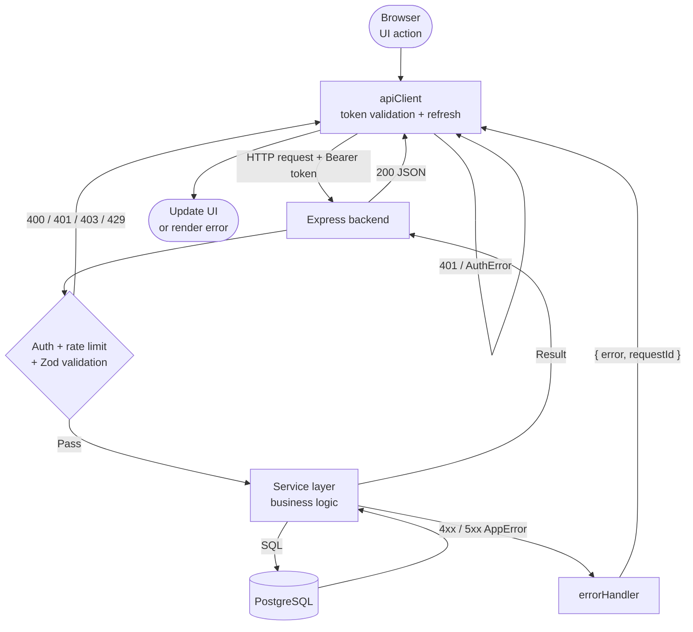

# Youth Services Application

Full-stack youth services management system — React + TypeScript frontend, Express + TypeScript backend, PostgreSQL.

## Stack

| Layer | Technology |
|---|---|
| Frontend | React 18, TypeScript, Vite |
| Backend | Express 4, TypeScript, postgres.js |
| Database | PostgreSQL |
| Auth | JWT access token (1h) + refresh token (8h httpOnly cookie) + 2FA via email |

---

## Full-Stack Request / Response Flow

Every user action in the browser becomes an HTTP request to the backend API. The backend validates the JWT, runs business logic, queries the database, and returns JSON.

**Zoom in:**

| Layer | Detail |
|-------|--------|
| Frontend HTTP pipeline | [frontend/docs/api-flow.mmd](frontend/docs/api-flow.mmd) — `apiClient` internals: token validation, proactive refresh, re-login modal, network errors |
| Backend auth | [backend/docs/auth.md](backend/docs/auth.md) — login, 2FA, token types, refresh rotation, logout |
| Backend errors | [backend/docs/errors.md](backend/docs/errors.md) — AppError hierarchy, errorHandler, response shape |
| Database | [backend/docs/db.md](backend/docs/db.md) — schema, migrations, backup system |

---

## Sub-docs

| Area | Doc |
|---|---|
| Frontend page structure & conventions | [frontend/STRUCTURE.md](frontend/STRUCTURE.md) |
| Backend setup & API reference | [backend/README.md](backend/README.md) |

---

## Quick Start

See [backend/README.md](backend/README.md) and [frontend/README.md](frontend/README.md) for setup instructions.
