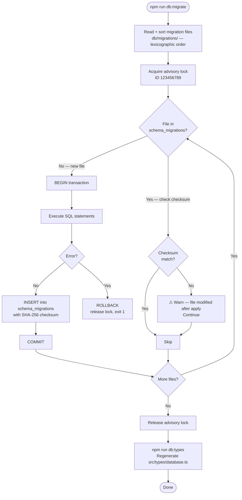
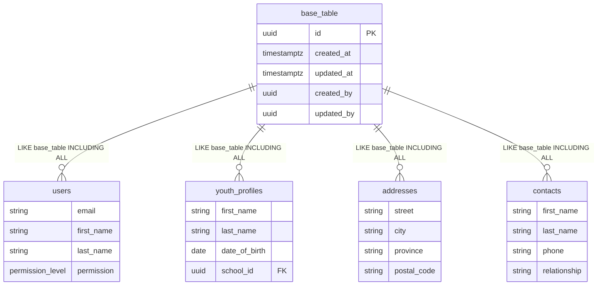

# Database & Migrations — Architecture & Design Notes

For commands and quick reference see [README.md § 9 Database & Migrations](../README.md#9-database--migrations) and [README.md § 14 Commands Reference](../README.md#14-commands-reference).

---

## Table of Contents

1. [Overview](#1-overview)
2. [Migration Files](#2-migration-files)
3. [Creating a Migration](#3-creating-a-migration)
4. [Safety Features](#4-safety-features)
5. [Backup System](#5-backup-system)
6. [Base Table Pattern](#6-base-table-pattern)

---

## 1. Overview

Migrations are plain `.sql` files — no ORM migration DSL, no `up`/`down` pairs. Every file runs once, in filename order, inside a single DB transaction. Applied files are tracked in `schema_migrations` with a SHA-256 checksum per file.



```
db/
├── migrations/
│   ├── 2026-01-31_1_init.sql
│   ├── 2026-01-31_2_init_backup.sql
│   └── YYYY-MM-DD_#_description.sql   ← all new files follow this naming
└── scripts/
    ├── migration_status.ts            ← db:status
    ├── update_schemas.ts              ← db:migrate + type regeneration
    └── generate_bu_migration.ts       ← db:generate-backup
```

---

## 2. Migration Files

**Naming convention:** `YYYY-MM-DD_#_description.sql`

- `YYYY-MM-DD` — date written (not applied)
- `#` — sequential integer within that date, starting at 1
- `description` — short snake_case summary of what the migration does

Files are applied in lexicographic filename order. Never rename a file after it has been applied — that breaks checksum tracking.

**Forward-only:** Never modify an applied migration. The runner stores a SHA-256 checksum for each applied file and warns on mismatch. If you need to change something, write a new migration.

---

## 3. Creating a Migration

**Step 1 — Write the SQL file:**

```sql
-- db/migrations/2026-02-01_3_add_posts.sql

CREATE TABLE posts (
  LIKE base_table INCLUDING ALL,
  title VARCHAR(255) NOT NULL,
  content TEXT,
  user_id UUID NOT NULL,
  FOREIGN KEY (user_id) REFERENCES users(id) ON DELETE CASCADE
);

CREATE INDEX idx_posts_user_id ON posts(user_id);
```

**Step 2 — Test locally:**

```bash
docker-compose exec backend npm run db:migrate:dry   # preview — no changes applied
docker-compose exec backend npm run db:migrate       # apply + auto-regenerates src/types/database.ts
docker-compose exec backend npm run db:status        # verify
```

`db:migrate` automatically runs `kysely-codegen` after applying migrations to keep `src/types/database.ts` in sync with the schema. If type generation fails, it will say so — run `npm run db:types` manually to retry.

**Step 3 — Generate backup infrastructure (if the table holds important data):**

```bash
docker-compose exec backend npm run db:generate-backup
docker-compose exec backend npm run db:migrate
```

**Step 4 — Commit:**

```bash
git add .
git commit -m "Add posts migration"
git push origin main
```

---

## 4. Safety Features

| Feature | Detail |
|---------|--------|
| Transaction safety | All statements in one transaction — error = full rollback |
| Concurrency | Advisory lock ID 123456789 prevents parallel runs |
| Checksum validation | SHA-256 per file — warns if an applied file is modified after apply |
| Dry-run mode | `npm run db:migrate:dry` previews without applying |

**Transaction safety** means a partially-applied migration is impossible — if any statement fails, the entire file rolls back cleanly.

**Checksum validation** guards against accidental edits. If you modify an already-applied file and re-run the migrator, it will emit a warning and continue. The migrator does not abort on checksum mismatch — the warning is informational. The fix is always to write a new migration, not edit the old one.

---

## 5. Backup System

`npm run db:generate-backup` inspects the current schema and auto-generates a new migration file that creates backup infrastructure for each data table.

For each table it generates:

- **`{table}_backup`** — shadow table with all original columns plus:
  - `original_id` — references the source row
  - `operation` — `'INSERT'` / `'UPDATE'` / `'DELETE'`
  - `changed_at` — timestamp of the change
  - `changed_by` — user who triggered the change (if available)
- **`BEFORE INSERT` trigger** — captures new records
- **`BEFORE UPDATE` trigger** — saves old column values before they are overwritten
- **`BEFORE DELETE` trigger** — archives the row before deletion

**Tables excluded from backups:**

| Category | Tables |
|----------|--------|
| Base/utility | `base_table` |
| Lookup/infrastructure | `user_permissions`, `user_groups`, `contact_types_base` |
| Security | `user_credentials`, `user_password_reset_tokens`, `user_auth_codes`, `user_trusted_devices`, `user_refresh_tokens`, `system_revoked_tokens` |
| System | `schema_migrations`, `schema_backup_tracking` |

Security tables are excluded because backing up credential hashes or reset tokens creates unnecessary copies of sensitive data.

---

## 6. Base Table Pattern

All data tables use `LIKE base_table INCLUDING ALL` to inherit a consistent set of audit columns. `INCLUDING ALL` copies constraints, indexes, defaults, and triggers — not just column definitions, so the `updated_at` auto-update trigger is inherited automatically.



**Rule:** every new data table must use `LIKE base_table INCLUDING ALL`. Never define `id`, `created_at`, `updated_at` manually.
