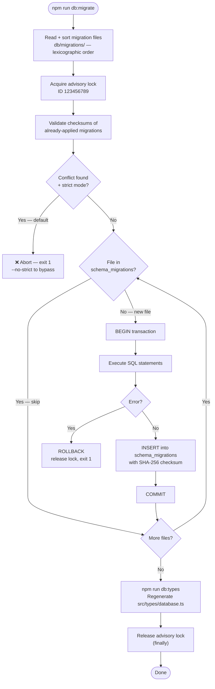
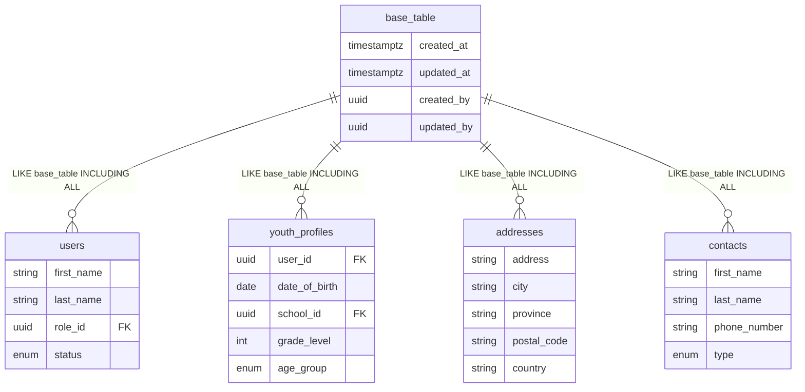

# Database & Migrations

For commands and quick reference see [README.md § 5 Database & Migrations](../README.md#5-database--migrations) and [README.md § 10 Commands Reference](../README.md#10-commands-reference).

---

## Table of Contents

1. [Overview](#1-overview)
2. [Migration Files](#2-migration-files)
3. [Creating a Migration](#3-creating-a-migration)
4. [Safety Features](#4-safety-features)
5. [Audit Log](#5-audit-log)
6. [Auth Log](#6-auth-log)
7. [Base Table Pattern](#7-base-table-pattern)

---

## 1. Overview

Migrations are plain `.sql` files — no ORM migration DSL, no `up`/`down` pairs. Every file runs once, in filename order. Each file runs atomically in its own transaction — the migration SQL and its tracking INSERT are wrapped in a single BEGIN/COMMIT. If a file fails, only that file rolls back; previously applied files in the same run are not affected. Applied files are tracked in `schema_migrations` with a SHA-256 checksum per file.



```
db/
├── migrations/
│   ├── 2026-01-31_1_init.sql
│   └── YYYY-MM-DD_#_description.sql   ← all new files follow this naming
└── scripts/
    ├── migration_status.ts            ← db:status
    └── update_schemas.ts              ← db:migrate + type regeneration
```

---

## 2. Migration Files

**Naming convention:** `YYYY-MM-DD_#_description.sql`

- `YYYY-MM-DD` — date written (not applied)
- `#` — sequential integer within that date, starting at 1
- `description` — short snake_case summary of what the migration does

Files are applied in lexicographic filename order. Never rename a file after it has been applied — that breaks checksum tracking.

**Forward-only:** Never modify an applied migration. The runner stores a SHA-256 checksum for each applied file and warns on mismatch. If you need to change something, write a new migration.

---

## 3. Creating a Migration

**Step 1 — Write the SQL file:**

```sql
-- db/migrations/2026-02-01_3_add_posts.sql

CREATE TABLE posts (
  LIKE base_table INCLUDING ALL,
  title VARCHAR(255) NOT NULL,
  content TEXT,
  user_id UUID NOT NULL,
  FOREIGN KEY (user_id) REFERENCES users(id) ON DELETE CASCADE
);

CREATE INDEX idx_posts_user_id ON posts(user_id);
```

**Step 2 — Test locally:**

```bash
docker compose exec backend npm run db:migrate   # apply + auto-regenerates src/types/database.ts
docker compose exec backend npm run db:status    # verify
```

`db:migrate` automatically runs `kysely-codegen` after applying migrations to keep `src/types/database.ts` in sync with the schema. If type generation fails, it will say so — run `npm run db:types` manually to retry.

---

## 4. Safety Features

| Feature | Detail |
|---------|--------|
| Transaction safety | Each file's statements run in their own transaction — error = that file rolls back only |
| Concurrency | Advisory lock ID 123456789 prevents parallel runs |
| Checksum validation | SHA-256 per file — all applied files validated upfront; aborts on mismatch in strict mode (default) |
| Strict mode | Default on — pass `--no-strict` to demote conflicts to warnings and continue |
| Missing file detection | Applied migration deleted from disk is treated as a conflict |

**Rule:** never edit an applied migration. If you need to change something, write a new one.

---

## 5. Audit Log

All INSERT, UPDATE, and DELETE operations made through the application are recorded in `audit_log` by `src/services/auditService.ts`.

### Table: `audit_log`

| Column | Type | Purpose |
|--------|------|---------|
| `id` | UUID | Primary key |
| `transaction_id` | UUID | Groups all changes from a single API request — supports undo/tracing |
| `user_id` | UUID | The staff/admin actor who triggered the change (nullable for system ops) |
| `table_name` | VARCHAR(100) | Target table name |
| `record_id` | UUID | PK of the affected row |
| `action` | VARCHAR(10) | `'INSERT'` / `'UPDATE'` / `'DELETE'` |
| `old_data` | JSONB | Row snapshot before change, plus related keys when needed for domain undo (null for INSERT) |
| `new_data` | JSONB | Row snapshot after change, plus related keys when needed for domain undo (null for DELETE) |
| `created_at` | TIMESTAMPTZ | When the entry was written |

### `auditService.ts` — `audit()`

```ts
import { audit } from '../services/auditService';

await audit(trx, userId, transactionId, 'youth_profiles', profileId, 'UPDATE', oldRow, newRow);
```

`audit()` must be called **inside an open transaction** (`trx` from `asTransactionSql()`). If the surrounding transaction rolls back, the audit entry rolls back with it — audit entries never exist without their corresponding data change.

### Nested write services

When one write service calls another inside a larger save flow, the parent service owns the transaction and passes `trx` downward. Child services should keep their reconciliation logic in a private helper that accepts `trx`, while the public entry point still supports standalone use by opening its own transaction when no `trx` is provided.

Current example:

- `youthService.ts` opens one transaction for `users`, `youth_profiles`, addresses, and contacts
- `setAddresses()` / `setContacts()` join that outer transaction when a `trx` is passed
- the same public methods still work standalone by calling `sql.begin(...)` when no `trx` is provided

### Coverage

| Service | Tables audited |
|---------|---------------|
| `youthService.ts` | `users`, `youth_profiles` (INSERT + UPDATE) |
| `staffService.ts` | `users` (INSERT + UPDATE + DELETE) |
| `addressService.ts` | `addresses` (UPDATE + INSERT), `user_has_addresses` (DELETE) |
| `contactService.ts` | `contacts` (UPDATE + INSERT), `user_has_contacts` (DELETE) |

### `transactionId`

Each service generates a `crypto.randomUUID()` per API call and passes it to every `audit()` call within that request. This lets you group all audit rows from a single "save youth profile" call even if it touched `users`, `youth_profiles`, `addresses`, and `contacts`.

---

## 6. Auth Log

Security events are recorded in `auth_log` by `src/services/authLogService.ts`. The write is fire-and-forget — auth operations never fail because logging failed.

### Table: `auth_log`

| Column | Type | Purpose |
|--------|------|---------|
| `id` | UUID | Primary key |
| `event` | VARCHAR(50) | Named event type — constrained by CHECK to 12 values |
| `user_id` | UUID | Nullable — absent for unknown-email login failures |
| `email` | TEXT | Email address involved (nullable) |
| `ip_hash` | TEXT | HMAC-SHA256 of the /24 subnet prefix — no raw IP stored |
| `device_fingerprint_hash` | TEXT | Device fingerprint hash (nullable) |
| `metadata` | JSONB | Event-specific data (failed attempt count, lock expiry, etc.) |
| `created_at` | TIMESTAMPTZ | When the entry was written |

### IP Privacy

Raw IP addresses are never stored. `authLogService.ts` hashes the subnet prefix:

- **IPv4** — first 3 octets: `192.168.1.x` → HMAC of `192.168.1`
- **IPv6** — first 4 groups: `2001:db8:85a3:0:x:…` → HMAC of `2001:db8:85a3:0`

HMAC key: `LOG_HMAC_SECRET` env var, falling back to `JWT_SECRET`. Hashes are usable for correlation within one deployment but not portable across deployments with different secrets.

### Events

| Event | Fired when |
|-------|------------|
| `login_success` | Trusted device bypass — full session issued without 2FA |
| `login_failure` | Bad password — includes `failedAttempts` in metadata |
| `account_locked` | 5th failed login — includes `lockedUntil` in metadata |
| `2fa_sent` | 2FA code sent after valid password |
| `2fa_resent` | Explicit resend request |
| `2fa_verified` | 2FA code accepted — session issued |
| `2fa_failed` | Invalid or expired 2FA code |
| `trusted_device_added` | Device recorded as trusted after successful 2FA |
| `logout` | User-initiated logout |
| `password_reset_requested` | Reset email dispatched |
| `password_reset_completed` | Password successfully changed via reset token |
| `token_reuse_detected` | Rotated-out refresh token presented — entire token family revoked |

### `authLog()` — fire-and-forget

```ts
import { authLog } from '../services/authLogService';

await authLog({
  event: 'login_failure',
  userId: user?.id,
  email,
  ipAddress: req.ip,
  metadata: { failedAttempts: attempts }
});
```

`authLog()` wraps the INSERT in its own `try/catch` and logs to `console.error` on failure. Auth flows are never blocked by a logging failure.

---

## 7. Base Table Pattern

All data tables use `LIKE base_table INCLUDING ALL` to inherit a consistent set of audit columns. `INCLUDING ALL` copies constraints, indexes, defaults, and storage parameters — not just column definitions. There is no `updated_at` auto-update trigger; services manually set `updated_at = NOW()` in every UPDATE query.



> Auth security tables (`user_refresh_tokens`, `system_revoked_tokens`, `user_auth_codes`, `user_trusted_devices`, `user_credentials`) and RBAC tables (`user_roles`, `user_permissions`, `user_role_has_permissions`) are also defined in the init migration but are omitted from the diagram for brevity.

**Rule:** every new data table must use `LIKE base_table INCLUDING ALL`. Always define `id UUID PRIMARY KEY DEFAULT gen_random_uuid()` first in the table — `id` is not in `base_table`. Never define `created_at`, `updated_at`, `created_by`, `updated_by` manually.
