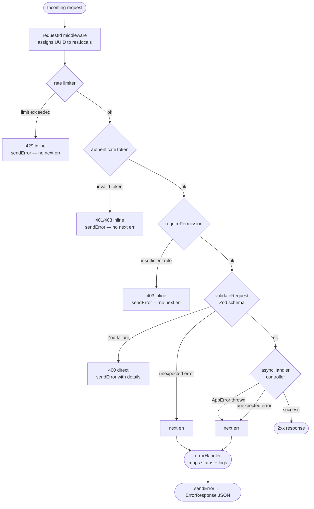

# Backend Error Handling

## 1. Error class hierarchy

`src/errors/AppError.ts` defines the base class, named subclasses, and the stable response type contract:

```
AppError (base, statusCode = 500)
├── BadRequestError        400
├── UnauthorizedError      401
├── ForbiddenError         403
├── NotFoundError          404
├── LockedError            423  (account lockout)
└── TooManyRequestsError   429  (rate limiting)
```

Services throw the appropriate subclass. The global error handler reads `statusCode` automatically.

```ts
import { NotFoundError } from '../errors/AppError';

throw new NotFoundError('User not found');
```

**Adding a new error type:** subclass `AppError`, set `statusCode` and `name`, then throw it from your service. The global handler picks it up automatically — no other wiring required.

`ConflictError` (409) is deferred until needed (e.g. duplicate email on staff create).

---

## 2. Response shape contract

All error responses from this API conform to `ErrorResponse` (exported from `src/errors/AppError.ts`):

```ts
interface ErrorResponse {
  error: string;
  details?: ValidationDetail[];  // only present on validation errors
  requestId?: string;            // present when requestId middleware is active
}

interface ValidationDetail {
  field: string;
  message: string;
}
```

`errorHandler`, `validateRequest`, and `authMiddleware` all call `sendError()` (exported from `AppError.ts`) rather than `res.json()` directly. `sendError` is the single formatting function — it assembles `ErrorResponse`, attaches `requestId` from `res.locals`, and sets the status. Changing the shape means changing one place.

Only `validateRequest` ever populates `details`. Auth middleware, the global handler, and the 404 handler all return `{ error: string }` only — `details` exists solely to surface per-field Zod failures to the client.

---

## 3. Global error handler

`src/middleware/errorHandler.ts` is registered in `src/index.ts` **after all routes and the 404 handler**:

```ts
app.use((req, res) => sendError(res, 404, 'Not found')); // unmatched routes
app.use(errorHandler);
```

Behaviour:
- If response already started, log with `requestId` and discard — forwarding to Express default could leak HTML or stack traces
- Always returns `ErrorResponse` JSON — never HTML, never a stack trace to the client
- Reads status from `err.statusCode`, validated as a number in 400–599 range; anything outside that (including plain thrown objects with garbage `statusCode`) falls back to 500
- 5xx → `console.error` (with stack); 4xx → `console.warn` (message only — pattern visibility without noise)
- In production: 5xx errors return a generic message; 4xx return the actual message (safe and useful to callers)
- In development: all errors return the actual message

Structured logging / Sentry / external error reporting is out of scope — extend `errorHandler` when needed.

**Error handler decision flow:**


---

## 4. `asyncHandler` — bridging Express 4 and async/await

Express 4 does not automatically catch rejected async route handlers. `asyncHandler` (exported from `errorHandler.ts`) wraps any async handler so rejections are forwarded to `next(err)`:

```ts
router.get('/', authenticateToken, asyncHandler(handleGetYouth));
```

**Every route must use `asyncHandler`.** One missed route = a silent unhandled promise rejection that Express never sees. There are no exceptions.

Sync throws inside `async` functions become rejected promises, so `asyncHandler` catches them too — you don't need try/catch in controllers.

**Express 5 note:** Express 5 handles async errors natively. When we upgrade, `asyncHandler` can be deleted from every route with no other changes needed.

---

## 5. Middleware order and where auth errors slot in



No route matched at all → 404 handler → `sendError(res, 404, 'Not found')` (never reaches `errorHandler`).

**404s are not logged by design.** The 404 path is fast and intentional — scan bots and bad routes are expected noise, not actionable signal. If you ever want to detect abuse patterns via 404 frequency, route through `next(new NotFoundError('Not found'))` instead so `errorHandler`'s warn logging picks it up.

**Bypass paths — be aware:** Rate limiter (429), auth (401/403), and 404 all respond directly via `sendError` and never reach `errorHandler`. Auth and rate limiter paths log via `console.warn` inline — repeated 401s and 429s are visible in logs without routing through the handler. The tradeoff is that any cross-cutting logic later added to `errorHandler` (metrics, tracing hooks) still won't apply to these paths; at that point, route them through `next(err)` instead.

`validateRequest` calls `sendError` directly for Zod errors (not `next(err)`) because the response shape includes `details`, which the global handler doesn't produce. Unexpected errors inside `validateRequest` do call `next(err)`. Its own `try/catch` around `schema.parseAsync()` makes it safe even if Zod parsing becomes async (e.g. DB-backed uniqueness checks).

---

## 6. Request tracing — requestId

`requestId` (exported from `src/middleware/errorHandler.ts`) is registered as the first middleware in `index.ts`. It assigns a UUID to every request:

- Stored on `res.locals.requestId`
- Returned as `X-Request-ID` response header so clients can correlate their requests with server logs
- `sendError()` picks it up automatically and includes it in `ErrorResponse` as `requestId`
- Auth inline logs include the `requestId` (e.g. `[auth] 401 Token expired [abc-123]`)

If the client sends an `X-Request-ID` request header, that value is used as-is (useful for end-to-end tracing across services).

**Log format standard:** All layers use the same format so logs are grep-friendly:

```
[requestId] layer status message
```

Examples:
```
[abc-123] auth 401 Token expired
[def-456] auth 403 Insufficient permissions — user: staff
[ghi-789] errorHandler 500 Database connection refused
[ghi-789] errorHandler error after response start (discarded): ...
```

The `requestId` field is always first so log lines can be sorted and correlated by request ID. Error messages are logged as plain strings — no `Error:` prefix — so all lines stay consistent.

**Future: include route in logs.** When request logging middleware is added, consider extending the format to `[requestId] layer status METHOD /path message` (e.g. `[abc-123] auth 401 GET /api/youth Token expired`). Deferred — not needed until log volume makes route context useful for triage.

**`sendError` scope:** `sendError` is purely a formatting + send function. It must not grow to include logging, metrics, or branching logic — those belong in `errorHandler` or dedicated middleware. Keeping it pure means every call site behaves identically and the function stays trivially testable.

**Success correlation follow-up:** `requestId` is on every response header (`X-Request-ID`) and in error bodies. Success response bodies do not include it — the header is sufficient for tracing. When request logging middleware is added (e.g. `[abc-123] GET /api/youth 200 45ms`), full request traces will tie errors and successes together by `requestId`.

---

## 7. Process-level crash protection

`src/index.ts` registers `process.on('uncaughtException')` and `process.on('unhandledRejection')` after `app.listen`. Both log the error and `process.exit(1)` so the container/process manager restarts cleanly rather than leaving the server in an undefined state. This covers errors that escape Express entirely — e.g. a rejected promise with no `.catch()` outside any request context.

**Requires a process manager** (Docker with restart policy, PM2, systemd, etc.). Without one, `process.exit(1)` terminates the server permanently and it won't come back.

**Test environments:** Both handlers are guarded behind `NODE_ENV !== 'test'`. Without the guard, an unhandled rejection in a test would call `process.exit(1)` and terminate the Jest runner mid-run with no output or test summary.

---

## 8. Frontend counterpart — ErrorBoundary

> Cross-cutting note. When the frontend error system grows, move this section into `frontend/docs/errors.md`.

`frontend/src/common/components/ErrorBoundary/ErrorBoundary.tsx` wraps the entire app in `main.tsx`.

It catches **render errors** (errors thrown during React's render or lifecycle phase). It does **not** catch:

- Errors inside event handlers (use try/catch in the handler)
- Errors in async code (promises, setTimeout)
- Server-side rendering errors

On error it shows a clean fallback UI with a reload button and logs the error + component stack to the console.

### Follow-up: frontend global error system (separate issue)

The backend now reliably returns consistent status codes + `ErrorResponse` JSON. The frontend error handling has not yet caught up:

1. **No global error UI** — each page handles errors independently, so error presentation is inconsistent across the app.
2. **`handleApiError` doesn't distinguish status codes** — it throws a plain `Error` with no `statusCode` property, so the frontend can't act differently on 400 vs 403 vs 500.
3. **No toast/notification system** — errors from background fetches or mutations with no visible error container are silently swallowed.

What a proper solution needs:
- Global notification/toast context (similar to the existing `ReLoginModal` pattern)
- `handleApiError` upgraded to throw a typed `ApiError` with a `statusCode` property
- Optionally: a global `unhandledrejection` listener for anything that slips through

Build this after this branch merges.

---

## 9. Future: domain errors vs transport errors

Currently services throw `AppError` subclasses directly (e.g. `throw new NotFoundError('User not found')`). This works well at this scale.

Longer term, consider separating domain errors from HTTP transport errors at the boundary between the service layer and the HTTP layer:

```ts
// service layer — domain language, HTTP-unaware
throw new UserNotFoundError();

// HTTP layer (route/controller) — maps domain errors to transport errors
catch (err) {
  if (err instanceof UserNotFoundError) throw new NotFoundError(err.message);
  throw err;
}
```

This keeps services unaware of HTTP, making them easier to test and reuse. Not needed now — add when services start being called from multiple contexts (e.g. HTTP + background jobs).

**Future: machine-readable error codes.** Adding a `code` field to `ErrorResponse` (e.g. `"NOT_FOUND"`, `"VALIDATION_ERROR"`) lets frontend logic branch on error type without string-matching `message`. Deferred until the frontend `ApiError` class is built — design both together so the contract is consistent end-to-end. Once introduced, codes must be treated as a stable, versioned contract: renaming or removing a code is a breaking change for any client that has branched on it.


