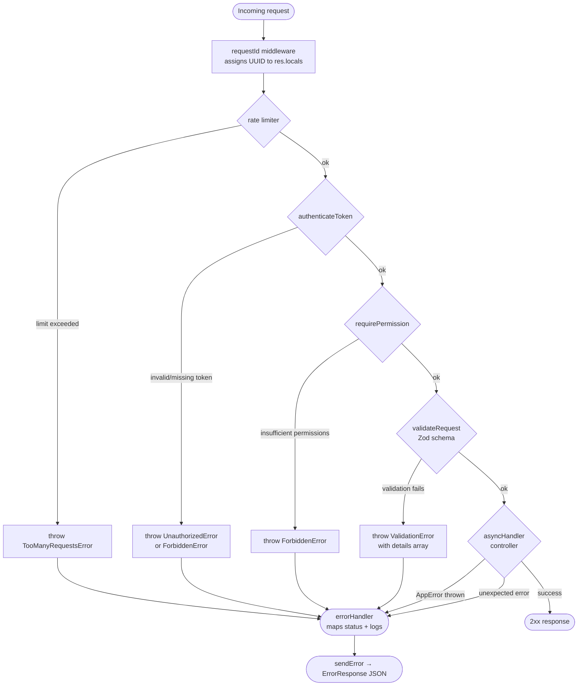

# Backend Error Handling

## Overview 

When something goes wrong in the backend:

1. A service (or middleware) **throws a typed error** — e.g. `throw new NotFoundError('User not found')`
2. That error flows to the **global error handler**, which reads the status code, logs it, and sends a clean JSON response
3. The client **always gets the same shape** — `{ error: "..." }` — regardless of what went wrong or where

You never need to `res.json()` an error yourself. Just throw the right class and the rest is handled.

---

## 1. Error classes — what to throw

All errors live in `src/errors/AppError.ts`, organized into two groups:

**Generic HTTP errors** — thrown from services and controllers:

```
AppError (base, default 500)
├── BadRequestError        400  — invalid input that passed schema validation
├── UnauthorizedError      401  — missing or invalid auth token
├── ForbiddenError         403  — authenticated but not allowed
├── NotFoundError          404  — resource doesn't exist
├── LockedError            423  — account locked out
└── TooManyRequestsError   429  — rate limit hit (thrown from rateLimiter middleware)
```

**Middleware-specific errors** — carry extra context the global handler surfaces:

```
└── ValidationError        400  — thrown from validateRequest, carries details[] array
```

**Usage in a service:**

```ts
import { NotFoundError } from '../errors/AppError';

throw new NotFoundError('User not found');
```

That's it. No `try/catch` in the controller, no `res.status().json()` — the global handler takes it from here.

**Adding a new error type:** subclass `AppError`, set `statusCode` and `name`, export it. The global handler picks it up automatically with no other changes required.

**Rule:** always `throw` — never call `sendError()` from outside `errorHandler`. Every layer (services, controllers, middleware) throws an `AppError` subclass. The global handler is the only place that calls `sendError()`. This makes the response shape, logging format, and request ID threading consistent for every error in the system.

> `ConflictError` (409) is not yet defined — add it in `AppError.ts` when you need it (e.g. duplicate email on staff create).

---

## 2. What the client receives

Every error response from this API has the same shape:

```ts
{
  error: string;           // always present — human-readable message
  details?: [              // only on validation errors (400)
    { field: string; message: string }
  ];
  requestId?: string;      // always present — use this when reporting bugs
}
```

**Example — wrong password:**
```json
{ "error": "Invalid email or password", "requestId": "abc-123" }
```

**Example — validation failure:**
```json
{
  "error": "Validation failed",
  "details": [
    { "field": "email", "message": "Invalid email address" }
  ],
  "requestId": "def-456"
}
```

The `requestId` links this response to a specific log line on the server — useful for debugging. See §6 for more.

All error responses are assembled by a single function: `sendError()` in `AppError.ts`, called only from `errorHandler`. Nothing else in the codebase calls `sendError` or `res.json()` for errors. Changing the shape means changing one place.

---

## 3. The global error handler

`src/middleware/errorHandler.ts` is registered in `src/index.ts` **after all routes**:

```ts
app.use((req, res) => sendError(res, 404, 'Not found')); // catch-all for unmatched routes
app.use(errorHandler);                                    // handles all thrown errors
```

What it does when an error arrives:

- **If the response has already started sending** — logs a warning and stops. Nothing else can be done safely at this point.
- **If the error is an `AppError` subclass** — uses its `statusCode` (only 400–599 are valid — anything else becomes 500)
- **If the error is anything else** (e.g. a plain `throw new Error(...)`) — treats it as a 500
- **Logging:** 5xx errors → `console.error` with full stack. 4xx errors → `console.warn` with message only (less noise).
- **Response message:** In production, 5xx errors return a generic `"An unexpected error occurred"` — no internal details leak to the client. 4xx errors always return the actual message. In development/test, all errors return the actual message.


### DB connection errors → 503

`errorHandler` has a special branch for postgres.js connection failures. If the error is not an `AppError` but matches known connection error patterns (`ECONNREFUSED`, `connect`, `57P03`, or `PostgresError` constructor name), it is treated as a 503 Service Unavailable rather than a 500:

- **Log:** `[rid] DATABASE UNAVAILABLE — query failed with no DB connection`
- **Response message:** `"The server is temporarily unavailable. Please try again shortly."` — generic, safe for clients
- **Status:** 503 (not 500 — allows load balancers and clients to distinguish a DB outage from a code bug)

The `/health` endpoint also pings the DB directly and returns `{ status: 'ok'|'degraded', db: 'ok'|'unavailable' }` with a 200 or 503.

---

## 4. `asyncHandler` — why every route needs it

Express 4 doesn't automatically catch errors from `async` route handlers. If an async function throws and there's no `asyncHandler` wrapper, Express never sees the error — it silently disappears.

`asyncHandler` (exported from `errorHandler.ts`) fixes this by forwarding any rejection to `next(err)`:

```ts
// correct — error is forwarded to the global handler
router.get('/', authenticateToken, asyncHandler(handleGetYouth));

// wrong — an error here silently disappears in Express 4
router.get('/', authenticateToken, handleGetYouth);
```

**Every route must use `asyncHandler`.** There are no exceptions. One missed route means a silent crash.

You don't need `try/catch` in your controllers because of this — just throw and let the handler deal with it.

> **Express 5 note:** Express 5 handles async errors natively. When we upgrade, `asyncHandler` can be removed from every route with no other changes.

---

## 5. How a request flows through the system

A request passes through middleware layers in order — rate limiter, auth, validation, then the controller. Any error at any step ends up in the global handler.

Here's the full path:



**A few things worth noting:**

- **Every layer throws.** Middleware (auth, rate limiter, validation, 404) is wrapped in `asyncHandler`, so thrown errors forward to `errorHandler` via `next(err)`. Services and controllers throw the same way. There is one error path — the global handler.
- **Validation errors (400)** carry a `details: ValidationDetail[]` array on the `ValidationError` instance. `errorHandler` reads `err.details` and includes it in the response body.
- **404s are not logged separately.** `app.use(...next(new NotFoundError('Not found')))` forwards to `errorHandler`, which logs at warn level.
---

## 6. Request tracing with `requestId`

Every request gets a unique ID the moment it arrives. This is what `requestId` middleware does (registered as the very first middleware in `index.ts`).

- The ID is stored on `res.locals.requestId`
- It's returned to the client as the `X-Request-ID` response header
- `sendError()` automatically includes it in every error response body as `requestId`
- All server log lines include it

**Why this matters:** If a user reports a bug and shares their `requestId`, you can find the exact log line that corresponds to their request — even across thousands of concurrent requests.

If the client sends an `X-Request-ID` request header, that value is used instead of generating a new one. Useful for tracing a request across multiple services.

**Log format:** Every layer logs in the same format so logs are easy to search:

```
[requestId] layer status message
```

Examples:
```
[abc-123] auth 401 Token expired
[def-456] auth 403 Insufficient permissions — user: staff
[ghi-789] errorHandler 500 Database connection refused
```

> **`sendError` is just a formatter** — it only assembles and sends the JSON. Logging, metrics, and branching logic belong in `errorHandler` or dedicated middleware, not in `sendError`.

---

## 7. Crash protection

Beyond request-level errors, `src/index.ts` also handles crashes that escape Express entirely — e.g. a rejected promise with no `.catch()` running outside a request:

```ts
process.on('uncaughtException', ...)
process.on('unhandledRejection', ...)
```

Both log the error and call `process.exit(1)` so the container restarts cleanly (via Docker restart policy) rather than limping along in a broken state.

> These handlers are disabled in `NODE_ENV=test`. Without that guard, an unhandled rejection in a test would call `process.exit(1)` and kill the Jest runner with no output.

---

## 8. Frontend — ErrorBoundary

`frontend/src/common/components/ErrorBoundary/ErrorBoundary.tsx` wraps the entire React app. It catches **render-phase errors** — errors thrown during React's render or component lifecycle.

It does **not** catch:
- Errors inside event handlers (use `try/catch` in the handler)
- Errors in async code (`fetch`, `setTimeout`, etc.)

On error it shows a clean fallback UI with a reload button rather than a blank screen.

### Frontend error handling

The frontend now has a typed error hierarchy in `src/common/utils/errors.ts` that mirrors what the backend sends:

| Class | Thrown by | When |
|---|---|---|
| `ApiError(status, message, details?, requestId?)` | `apiClient` | Server returned 4xx/5xx — preserves status, Zod field errors, and requestId |
| `AuthError` | `apiClient` | No token in storage when a protected call is made |
| `NetworkError` | `apiClient`, `tokenRefresh` | `fetch` threw TypeError — no connection |
| `RequestTimeoutError` | `apiClient` | AbortController timeout fired |

`handleApiError` has been removed. All HTTP calls go through `apiClient` (`src/common/api/client.ts`) which throws typed errors. Hooks catch with `getErrorMessage(err, fallback)` for display; they can also do `err instanceof ApiError && err.details` to map field-level validation errors.

Still outstanding: no global toast/notification system — errors from background fetches rely on component-level state.

---

## 9. Design choices — why it's built this way

These are deliberate decisions, not accidents. If you're tempted to "simplify" any of them, read this first.

### 9.1 Two files: `AppError.ts` (vocabulary) + `errorHandler.ts` (policy)

`AppError.ts` defines **what errors exist** — the classes, the response shape, the `sendError` formatter. It's pure data and is imported by ~30 service and middleware files.

`errorHandler.ts` defines **what to do at runtime** — status mapping for unknown errors (DB outage → 503, anything else → 500), log levels (5xx → error+stack, 4xx → warn), production message redaction, and the `asyncHandler`/`requestId` helpers. It's imported only by `index.ts`.

Merging them would force every service that throws an error to also pull in Express middleware code it doesn't need. The split keeps the dependency graph one-directional: services depend on vocabulary, vocabulary doesn't depend on Express middleware policy.

### 9.2 One class per status code (vs. factory or single `AppError(status, msg)`)

Three options were considered:

| Approach | Pros | Cons |
|---|---|---|
| **Class per status** (current) | Self-documenting throw sites, real `instanceof` checks, precise stack traces, greppable (`class NotFoundError`) | ~6 lines per class |
| Factory (`makeError('NotFoundError', 404)`) | ~30 fewer lines | All errors share one constructor frame in stack traces, "Go to definition" lands on a one-liner, can't extend a single class with extra fields later |
| Single `AppError(status, message)` | Minimal | Magic numbers at every throw site, no named types for `catch` branches |

Debuggability beats line count. Stack traces should point at the specific class, not a shared factory. Kept the explicit version.

### 9.3 Middleware throws + still calls `next()` on success

Express middleware advances the chain *only* when `next()` is called. Returning from an async function — even one that resolves — does **not** advance. This is the Express 4 middleware contract and applies regardless of whether the function is async.

`asyncHandler` only handles the *error* path: it catches rejections and forwards them via `next(err)`. It can't auto-call `next()` on success because it doesn't know whether the wrapped function is middleware (needs `next()`) or a route handler (sends a response and stops).

So every middleware looks like:

```ts
export const xMiddleware = asyncHandler(async (req, _res, next) => {
  if (badCondition) throw new SomeAppError('message');
  next();   // required — handing off to the next middleware
});
```

The asymmetry (errors auto-forward, success is manual) is the cost of using a 2010-era callback API with modern async/await. Express 5 fixes the error half but not this — the `next()` call stays. Migrating to Fastify/Hono/Koa would remove it; not worth it for this app.

### 9.4 `ValidationError` is the only middleware-specific error class

All the generic HTTP errors (`BadRequestError`, `NotFoundError`, etc.) carry only a `message` and a `statusCode`. `ValidationError` is the only one that needs to ship structured payload (the `details: ValidationDetail[]` array of field-level errors from Zod) back to the client.

Rather than overload `BadRequestError` with an optional `details` parameter that's only used in one place, `ValidationError` is its own class. The base `AppError` carries the `details` field so `errorHandler` can read it uniformly without an `instanceof ValidationError` check.

If a future error type needs to carry structured payload (e.g. a `ConflictError` that includes the conflicting record's id), the same pattern applies: subclass `AppError`, add the field, populate it in the constructor.

---

## 10. Future improvements

Not needed yet, but worth considering later:

- Add machine-readable error codes once the frontend has a typed `ApiError`.
- Consider domain errors if services are reused outside HTTP routes.
- Add structured logging or external error reporting when log volume grows.


