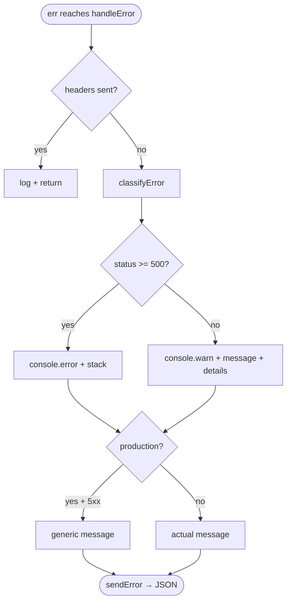
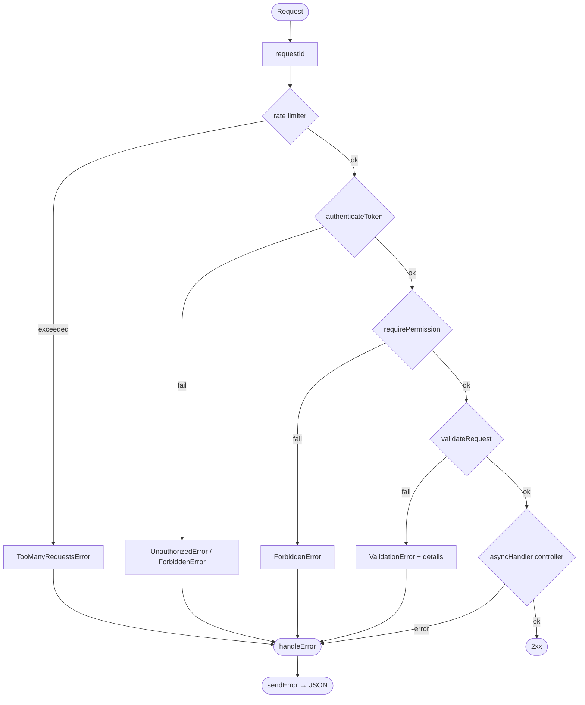

# Backend Error Handling

## Overview

1. A service (or middleware) **throws a typed error** — e.g. `throw new NotFoundError('User not found')`
2. That error flows to the **global error handler**, which reads the status, logs it, and sends a JSON response
3. The client always gets the same shape — `{ error: "..." }`

Never `res.json()` an error. Just throw and the rest is handled.

### Files

| File | What lives there |
|---|---|
| `src/errors.ts` | All error classes, `ErrorResponse` type, `ValidationDetail` type |
| `src/middleware/errorMiddleware.ts` | `classifyError`, `handleError`, `sendError`, `asyncHandler` |
| `src/types/` | TypeScript shape declarations only — no runtime logic |

---

## 1. Error classes

```
AppError (base, 500)
├── BadRequestError        400
├── ValidationError        400  — carries details[] (Zod field errors)
├── UnauthorizedError      401
├── ForbiddenError         403
├── NotFoundError          404
├── ConflictError          409  — mapped from Postgres 23505
├── LockedError            423
├── TooManyRequestsError   429
├── DbConnectionError      503  — DB unreachable
├── ServiceUnavailableError 503 — upstream dependency down
└── InternalServerError    500  — unexpected error
```

```ts
import { NotFoundError } from '../errors';

throw new NotFoundError('User not found');
```

**Adding a new type:** subclass `AppError`, set `statusCode` and `name` — the handler picks it up automatically.

**Rule:** always `throw` — never call `sendError()` from outside `handleError`.

> `ConflictError` (409) is automatically thrown by `classifyError()` in `errorMiddleware.ts` when Postgres raises a `23505` unique_violation. The original DB error is passed as `cause`, so the constraint name is visible in logs. You can also throw it directly from a service for semantic conflicts.

---

## 2. Response shape

```ts
{
  error: string;           // always present
  details?: [              // validation errors only
    { field: string; message: string }
  ];
  requestId?: string;      // always present
}
```

**Example — wrong password:**
```json
{ "error": "Invalid email or password", "requestId": "abc-123" }
```

**Example — validation failure:**
```json
{
  "error": "Validation failed",
  "details": [{ "field": "email", "message": "Invalid email address" }],
  "requestId": "def-456"
}
```

---

## 3. Global error handler

`handleError` is registered last in `index.ts`. Flow: `classifyError` → status + log → `sendError`.

- Headers already sent → log + bail
- Status from `appErr.statusCode` (clamped 400–599, else 500)
- 5xx → `console.error` + full stack; 4xx → `console.warn` + message + details + cause
- Production 5xx → `appErr.clientMessage ?? 'An unexpected error occurred'`; 4xx always actual message



> Logging is `console.error`/`console.warn`. Swapping to a structured logger (Pino, Winston) is a one-line change — `Error.cause` is already threaded through `AppError` so the full cause chain serialises automatically.

### DB error classification

`classifyError()` promotes raw throws into typed `AppError`s before logging:

- Already an `AppError` → returned as-is
- Connection failures (`ECONNREFUSED`, `57P03`, pool exhaustion, etc.) → `DbConnectionError` (503)
- `23505` unique violation → `ConflictError` (409), original postgres error passed as `cause`
- Everything else → `InternalServerError` (500)

The `/health` endpoint pings the DB directly and returns `{ status: 'ok'|'degraded', db: 'ok'|'unavailable' }` with 200 or 503.

---

## 4. `asyncHandler`

Express 4 silently drops async errors without it. Every route must use it — no exceptions.

```ts
// correct — error forwarded to the global handler
router.get('/', authenticateToken, asyncHandler(handleGetYouth));

// wrong — error silently disappears in Express 4
router.get('/', authenticateToken, handleGetYouth);
```

No `try/catch` needed in controllers — just throw.

---

## 5. Request flow



---

## 6. Request tracing

Every request gets a UUID on arrival (`requestId` middleware, first in `index.ts`). Stored on `res.locals.requestId`, returned as `X-Request-ID` header, included in every error response and log line.

Pass `X-Request-ID` in the request to override (useful for cross-service tracing).

---

## 7. Crash protection

`src/index.ts` registers `uncaughtException` and `unhandledRejection` handlers — both log and call `process.exit(1)` so Docker restarts cleanly. Both are disabled in `NODE_ENV=test`.

---

## 8. Frontend

`ErrorBoundary` wraps the app and catches render-phase errors. Does **not** catch event handler or async errors.

Typed error hierarchy in `src/common/utils/clientErrors.ts`:

| Class | When |
|---|---|
| `ApiError(status, message, details?, requestId?)` | Server returned 4xx/5xx |
| `AuthError` | No token when a protected call is made |
| `NetworkError` | `fetch` threw — no connection |
| `RequestTimeoutError` | AbortController timeout fired |

All HTTP calls go through `apiClient`. Hooks catch with `getErrorMessage(err, fallback)` for display; `err instanceof ApiError && err.details` for field-level validation errors.

---

## 9. Design notes

- **One class per status code** — self-documenting throw sites, real `instanceof` checks, precise stack traces. A factory saves lines but loses "Go to Definition" and per-class fields.
- **`errors.ts` (vocabulary) vs `errorMiddleware.ts` (policy)** — error classes are imported by ~30 service files; keeping them separate from Express middleware keeps the import graph one-directional.
- **`ValidationError` carries `details[]`** — other errors only need a message. `AppError.details` is on the base class so `handleError` reads it uniformly without an `instanceof` check.
- **`sendError` is private** — the only function that writes `res.json()` for errors. Shape changes happen in one place.
