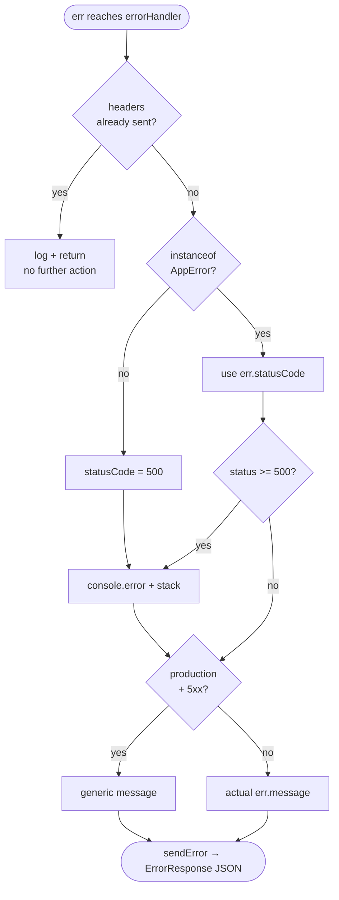
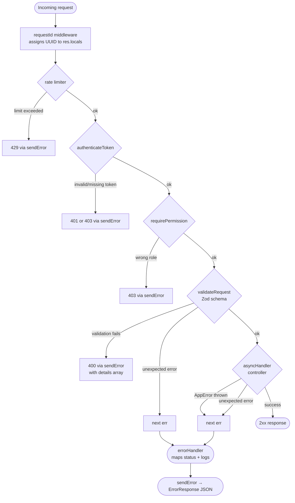

# Backend Error Handling

## Overview 

When something goes wrong in the backend:

1. A service (or middleware) **throws a typed error** — e.g. `throw new NotFoundError('User not found')`
2. That error flows to the **global error handler**, which reads the status code, logs it, and sends a clean JSON response
3. The client **always gets the same shape** — `{ error: "..." }` — regardless of what went wrong or where

You never need to `res.json()` an error yourself. Just throw the right class and the rest is handled.

---

## 1. Error classes — what to throw

All errors live in `src/errors/AppError.ts`. Pick the one that matches the situation:

```
AppError (base, default 500)
├── BadRequestError        400  — invalid input that passed schema validation
├── UnauthorizedError      401  — missing or invalid auth token
├── ForbiddenError         403  — authenticated but not allowed
├── NotFoundError          404  — resource doesn't exist
├── LockedError            423  — account locked out
└── TooManyRequestsError   429  — rate limit hit
```

**Usage in a service:**

```ts
import { NotFoundError } from '../errors/AppError';

throw new NotFoundError('User not found');
```

That's it. No `try/catch` in the controller, no `res.status().json()` — the global handler takes it from here.

**Adding a new error type:** subclass `AppError`, set `statusCode` and `name`, export it. The global handler picks it up automatically with no other changes required.

> `ConflictError` (409) isn't here yet — it'll be added when we need it (e.g. duplicate email on staff create).

---

## 2. What the client receives

Every error response from this API has the same shape:

```ts
{
  error: string;           // always present — human-readable message
  details?: [              // only on validation errors (400)
    { field: string; message: string }
  ];
  requestId?: string;      // always present — use this when reporting bugs
}
```

**Example — wrong password:**
```json
{ "error": "Invalid email or password", "requestId": "abc-123" }
```

**Example — validation failure:**
```json
{
  "error": "Validation failed",
  "details": [
    { "field": "email", "message": "Invalid email address" }
  ],
  "requestId": "def-456"
}
```

The `requestId` links this response to a specific log line on the server — useful for debugging. See §6 for more.

All error responses are assembled by a single function: `sendError()` in `AppError.ts`. Nothing calls `res.json()` directly for errors. Changing the shape means changing one place.

---

## 3. The global error handler

`src/middleware/errorHandler.ts` is registered in `src/index.ts` **after all routes**:

```ts
app.use((req, res) => sendError(res, 404, 'Not found')); // catch-all for unmatched routes
app.use(errorHandler);                                    // handles all thrown errors
```

What it does when an error arrives:

- **If the response has already started sending** — logs a warning and stops. Nothing else can be done safely at this point.
- **If the error is an `AppError` subclass** — uses its `statusCode` (only 400–599 are valid — anything else becomes 500)
- **If the error is anything else** (e.g. a plain `throw new Error(...)`) — treats it as a 500
- **Logging:** 5xx errors → `console.error` with full stack. 4xx errors → `console.warn` with message only (less noise).
- **Response message:** In production, 5xx errors return a generic `"An unexpected error occurred"` — no internal details leak to the client. 4xx errors always return the actual message. In development/test, all errors return the actual message.



---

## 4. `asyncHandler` — why every route needs it

Express 4 doesn't automatically catch errors from `async` route handlers. If an async function throws and there's no `asyncHandler` wrapper, Express never sees the error — it silently disappears.

`asyncHandler` (exported from `errorHandler.ts`) fixes this by forwarding any rejection to `next(err)`:

```ts
// correct — error is forwarded to the global handler
router.get('/', authenticateToken, asyncHandler(handleGetYouth));

// wrong — an error here silently disappears in Express 4
router.get('/', authenticateToken, handleGetYouth);
```

**Every route must use `asyncHandler`.** There are no exceptions. One missed route means a silent crash.

You don't need `try/catch` in your controllers because of this — just throw and let the handler deal with it.

> **Express 5 note:** Express 5 handles async errors natively. When we upgrade, `asyncHandler` can be removed from every route with no other changes.

---

## 5. How a request flows through the system

A request passes through middleware layers in order — rate limiter, auth, validation, then the controller. Any error at any step ends up in the global handler.

Here's the full path:



**A few things worth noting:**

- **Rate limiter, auth, and 404** all call `sendError` directly and never reach `errorHandler`. This is intentional — they're fast, well-understood paths. The tradeoff is that any future cross-cutting logic added to `errorHandler` (metrics, tracing) won't apply to them without extra work.
- **Validation errors (400)** also bypass `errorHandler` because they include a `details` array that the global handler doesn't produce.
- **404s are not logged.** Unmatched routes are expected noise (scan bots, bad links). If you want to detect abuse via 404 patterns, route through `next(new NotFoundError(...))` instead.

---

## 6. Request tracing with `requestId`

Every request gets a unique ID the moment it arrives. This is what `requestId` middleware does (registered as the very first middleware in `index.ts`).

- The ID is stored on `res.locals.requestId`
- It's returned to the client as the `X-Request-ID` response header
- `sendError()` automatically includes it in every error response body as `requestId`
- All server log lines include it

**Why this matters:** If a user reports a bug and shares their `requestId`, you can find the exact log line that corresponds to their request — even across thousands of concurrent requests.

If the client sends an `X-Request-ID` request header, that value is used instead of generating a new one. Useful for tracing a request across multiple services.

**Log format:** Every layer logs in the same format so logs are easy to search:

```
[requestId] layer status message
```

Examples:
```
[abc-123] auth 401 Token expired
[def-456] auth 403 Insufficient permissions — user: staff
[ghi-789] errorHandler 500 Database connection refused
```

> **`sendError` is just a formatter** — it only assembles and sends the JSON. Logging, metrics, and branching logic belong in `errorHandler` or dedicated middleware, not in `sendError`.

---

## 7. Crash protection

Beyond request-level errors, `src/index.ts` also handles crashes that escape Express entirely — e.g. a rejected promise with no `.catch()` running outside a request:

```ts
process.on('uncaughtException', ...)
process.on('unhandledRejection', ...)
```

Both log the error and call `process.exit(1)` so the container restarts cleanly (via Docker restart policy) rather than limping along in a broken state.

> These handlers are disabled in `NODE_ENV=test`. Without that guard, an unhandled rejection in a test would call `process.exit(1)` and kill the Jest runner with no output.

---

## 8. Frontend — ErrorBoundary

`frontend/src/common/components/ErrorBoundary/ErrorBoundary.tsx` wraps the entire React app. It catches **render-phase errors** — errors thrown during React's render or component lifecycle.

It does **not** catch:
- Errors inside event handlers (use `try/catch` in the handler)
- Errors in async code (`fetch`, `setTimeout`, etc.)

On error it shows a clean fallback UI with a reload button rather than a blank screen.

### What's still missing on the frontend

The backend consistently returns `{ error, requestId }` with correct status codes. The frontend hasn't caught up yet:

| Problem | Impact |
|---|---|
| Each page handles errors independently | Inconsistent error UI across the app |
| `handleApiError` throws a plain `Error` with no status code | Frontend can't distinguish 400 vs 403 vs 500 |
| No toast/notification system | Errors from background fetches are silently swallowed |

Planned fix (separate issue after this branch merges):
- Global notification/toast context
- `handleApiError` upgraded to a typed `ApiError` with a `statusCode` property
- Optional: global `unhandledrejection` listener for anything that slips through

---

## 9. Future improvements

Not needed yet, but worth considering later:

- Add machine-readable error codes once the frontend has a typed `ApiError`.
- Consider domain errors if services are reused outside HTTP routes.
- Add structured logging or external error reporting when log volume grows.


