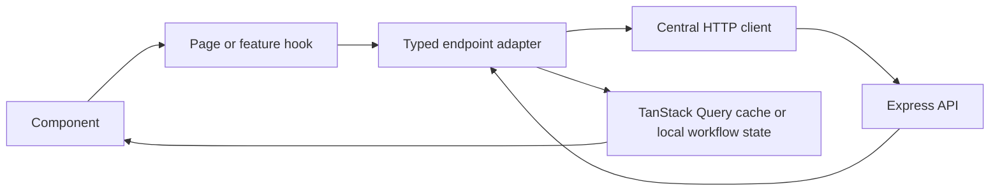

# Frontend Architecture

The frontend is a React application organized around route-family ownership, reusable business capabilities, generic UI primitives, and explicit root infrastructure. The primary dependency direction is:

Unless stated otherwise, source paths in this document are relative to `frontend/`.

```text
pages → common/features → common components, hooks, and utilities
  └────────────────────→ app, auth, http, and query infrastructure
```

## Data flow



- Components render state and delegate meaningful behavior to focused hooks.
- Endpoint adapters own paths and response types; all network traffic passes through `src/http/client.ts`.
- TanStack Query owns server state. Page or feature query-key modules define stable prefixes, read hooks own loading and error presentation, and mutation owners invalidate or reconcile the cache.
- Local React state owns transient UI state such as open modals, draft form values, selections, and view controls.
- Write flows update or invalidate the relevant query cache rather than maintaining a second unsynchronized server-state copy.

The complete browser-to-database lifecycle is documented in [`http.mmd`](http.mmd).

## Top-level ownership

| Directory | Owns |
|---|---|
| `src/app/` | Route composition, root providers, and root failure handling |
| `src/auth/` | Authentication state, durable token storage, refresh, device identity, and re-authentication coordination |
| `src/http/` | API URL configuration, authenticated transport, timeouts, and typed client errors |
| `src/query/` | Application query client and generic list/cache adapters |
| `src/pages/` | Route-family UI, page-specific APIs, hooks, schemas, types, and behavior |
| `src/common/features/` | Business-aware capabilities reused by multiple page families |
| `src/common/components/` | Domain-agnostic UI and interaction primitives |
| `src/common/hooks/` | Small domain-agnostic reusable hooks |
| `src/common/utils/` | Pure shared helpers |
| `src/common/styles/` | Shared design and layout styles |

## Current layout

```text
src/
  app/                    root composition and ErrorBoundary
  auth/                   auth API, provider, storage, refresh, and re-auth
  http/                   apiClient, URL configuration, and client errors
  query/                  QueryClient and reusable query adapters
  common/
    components/           generic UI and interaction primitives
    features/             cross-page business capabilities
    hooks/                generic shared hooks
    styles/               shared styling foundations
    utils/                pure date, time, and other helpers
  pages/
    Auth/                 login, verification, and password flows
    Homepage/             public homepage and managed homepage content
    Outreach/             expressions of interest and leads
    Programming/          cohorts, sessions, attendance, and reports
    Settings/             account and user administration
    Staff/                staff workflows such as timesheets
    Youth/                youth profiles, attendance, and notes
```

This is an ownership map, not an exhaustive file inventory. The source tree remains the authority for current page and component names.

## Boundary rules

- Page-specific code stays under its page or route family.
- Business behavior with multiple page owners belongs under `common/features/<domain>/`.
- Domain-agnostic reusable UI belongs under `common/components/`.
- Root technical concerns stay in `app`, `auth`, `http`, or `query`; they are not placed in `common` merely because many pages use them.
- Pages may consume common features, generic common code, and root infrastructure.
- Common features must not import pages.
- Common components must not import pages or common features.
- A page never imports another page's private API, hook, component, or type. Promote a genuinely shared contract to the narrowest common owner.
- The authenticated HTTP client and auth subsystem form an explicit integration boundary: auth endpoints use the HTTP client, while authenticated requests consume auth token and re-authentication primitives.

Local guides refine the two shared-code boundaries:

- [`common/components/README.md`](../../frontend/src/common/components/README.md)
- [`common/features/README.md`](../../frontend/src/common/features/README.md)

Data pages compose one route-level `PageHeader` followed by `PageBody`. `PageBody`
owns the shared `page-dashboard` region and exactly one `page-table` or
`page-calendar` region; page-specific wrappers must not recreate that structure.

Create a route-family layout only when sibling routes share persistent rendered UI, state, or coordination. A common URL prefix, redirect, permission, or identical page-shell classes does not justify an `Outlet`-only layout; in that case each concrete route owns its `main.page-container` shell and receives its own route guard.

## Feature folders

A non-trivial unit owns its UI, stateful behavior, validation, types, and tests together:

```text
components/
  FeatureName/
    FeatureName.tsx
    FeatureName.css
    useFeatureName.ts
    featureNameSchema.ts
    FeatureName.test.tsx
```

Use only the files the feature needs. The important boundary is that the entry component composes focused units instead of accumulating unrelated effects, observers, state machines, and data adapters.

Substantial data pages use nested ownership rather than leaving every page-private unit as a peer:

```text
Page.tsx                         route shell and cross-view orchestration
components/
  FeatureListView/              remote list query, table, and list-only helpers
    hooks/
  FeatureCalendarView/          calendar buffer, filtering, items, and interactions
    hooks/
    FeatureItem/
  FeatureDashboard/             dashboard composition
    FeatureDashboardCard/
hooks/                          page-wide controls and cross-view workflows
featureViewData.ts              contracts or pure helpers shared by sibling views
```

The route owns the header, shared filters and preferences, dialogs, selection context, dashboards, and synchronization between mounted or unmounted views. A `*ListView` owns its remote list hook and table-specific behavior. A `*CalendarView` owns its range loader, buffer adapter, visible-data hook, item component, and calendar-only mutation helpers. A dashboard owns cards used only within that dashboard. Do not move a contract under one child when a sibling view or the route also consumes it; keep that contract at the narrowest shared feature level.

Name the structural dashboard owner `*Dashboard`, not `*Overview`, and name extracted card components `*DashboardCard`. A semantic qualifier may precede that suffix, such as `TaskOverviewDashboardCard`. Reserve “overview” by itself for domain content, aggregate data, and hooks; it must not become an alternate structural name for either the dashboard owner or an extracted dashboard card.

The same public ownership pattern does not require identical internal algorithms. Point records and ranged records may use different calendar-data shapes and caching strategies while exposing the same `loaded data + filters → visible calendar data` responsibility from their respective CalendarView-owned hooks.

- Extract a component when a UI region owns meaningful rendering, interaction, or accessibility behavior.
- Extract a hook when stateful behavior has a coherent name and owns effects, subscriptions, observers, or coordinated callbacks.
- Extract pure transforms, constants, date arithmetic, and external-library adapters into utilities.
- Keep one-off private prop types beside their component; place cross-unit contracts in the feature's type file.
- Introduce `components/` or `hooks/` subdirectories when multiple peer units make a flat feature directory unclear.
- Place focused tests with the narrowest owner. Keep route tests for composition and boundary wiring; move hook policy, persistence, filtering, caching, and reference-stability assertions into the owning hook suite instead of duplicating them in page tests.

## Type and API ownership

```text
types ← endpoint adapter ← query/workflow hook ← component
```

- Endpoint adapters type every `apiClient` call at the transport boundary.
- Hooks and components consume typed results instead of casting transport data.
- API modules do not own rendering or React state.
- Shared domain contracts live with the common feature that owns the domain; generic cross-domain contracts may live in a focused common type module.

## State ownership

| State | Owner |
|---|---|
| Remote lists and records | TanStack Query cache through page/feature hooks |
| Authentication session | `auth/` provider and storage services |
| Form fields and validation | The owning form hook/component, usually React Hook Form and Zod |
| Modal lifecycle and submit status | The owning modal feature |
| Cross-page user preferences | `common/features/preferences/` |
| High-frequency transient interaction state | Focused hooks and refs when values do not affect declarative rendering |

Query keys remain stable and domain-specific. Paginated lists use a dedicated list prefix so cache helpers cannot touch another query shape. Mutation owners invalidate server-filtered lists by default, update rows directly only when membership and order cannot change, and invalidate every domain changed by a cross-domain command. Cache writes preserve unaffected object references where practical, and mutation flows define how stale or overlapping responses are prevented from overwriting newer state.

Focused mutation hooks present their public workflows in domain order: create/add, edit/update, delete, then other actions. When several workflows reconcile the same query cache, they share one helper that owns the cache-missing fallback and each workflow supplies only its validity check and transformation.

## Naming

- Page and component folders use PascalCase.
- Hooks use `useX.ts` naming.
- Endpoint adapter files end in `.api.ts`.
- Tests are colocated with the public unit or behavior they cover.

The page creation workflow is documented in [`../development/frontend/adding-a-page.md`](../development/frontend/adding-a-page.md). Testing commands and test-runner ownership are documented in [Testing](../operations/testing.md).

Browser-sensitive shared interactions use Playwright component stories. The
gallery under `frontend/playwright/gallery/` runs colocated `*.story.tsx`
scenarios through the application's Vite pipeline, while specs under
`frontend/playwright/tests/` exercise them in real Chromium.
