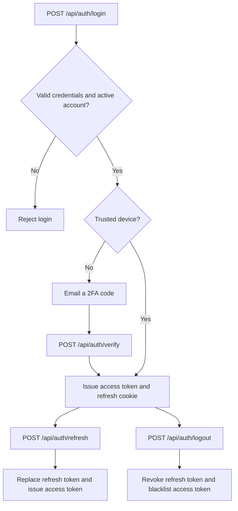

# Authentication and Permissions

For API areas and request contracts, see the [API overview](api.md).
[Auth routes](../../backend/src/routes/authRoutes.ts) own endpoint composition and
[authService.ts](../../backend/src/services/auth/authService.ts) owns session operations.

## Session Flow

Only active accounts may log in. Five consecutive failed password attempts lock an account for 15 minutes. A 2FA code expires after 5 minutes. Adding or reconfirming a trusted device during 2FA sets trust for 30 days.

Login responses use `requiresVerification: true` when the caller must enter a
2FA code. The frontend API, Login page, and re-login dialog use that same field.

| Contract | Access token | Refresh token |
|---|---|---|
| Secret | `JWT_SECRET` | `REFRESH_SECRET` |
| TTL | 4 hours | 8 hours |
| Sent as | `Authorization: Bearer` header | `httpOnly` cookie (`sameSite: 'strict'`, `secure` in production only) |
| Contains `role` + `permissions[]` | ✓ | ✗ |
| `tokenType` claim | `'access'` | `'refresh'` |
| Stored in DB | ✗ (blacklist only on logout) | ✓ (`user_refresh_tokens` table) |

## Roles and Permissions

Route access and mutations are permission-based. Roles group permissions in the database and may also shape authorized results or presentation—for example, administrators can manage staff and youth accounts while staff can manage youth accounts only. A role check must never replace the route permission check.

The [authorization and policy guide](authorization.md) owns record scope, enforcement, consumer capabilities, and permission changes.

Staff program scope is assignment-based for every program. A program's `enrollment_required` flag controls whether youth must enroll before attendance; it does not automatically grant staff access. Administrators can assign both enrolled- and open-roster programs to staff accounts. Project managers have access to all programs without individual assignments; this does not grant administrator scope over accounts or coworkers’ hours/tasks.

### Roles and Their Permissions

| Role | Permissions |
|------|-------------|
| `admin` | All currently defined permissions, including account, youth, programming, outreach, homepage, settings, and hours access |
| `project_manager` | All staff permissions plus `write:programs`; all-program scope for programs, cycles, rosters, and sessions; other workflows retain staff scope |
| `staff` | Operational permissions assigned by migrations; account results and some workflows remain policy-scoped |
| `youth` | *(none)* |

### Permission Definitions

The [Permission union](../../backend/src/types/auth.ts) lists supported capability
names. [Route modules](../../backend/src/routes) declare the permissions required
by each endpoint; [policies](../../backend/src/policies) determine record scope.
Role grants are persisted in `user_role_has_permissions` through data migrations.

### How Permissions Flow into a Token

Minimal shared lookups use the consuming workflow's capability rather than
requiring program or school management access. See [Reference Data](reference-data.md)
for alternative lookup permissions, authenticated assigned-program labels, and
feature-specific staff scope. `requireAnyPermission(...)` accepts any listed
capability; `requirePermission(...)` continues to require all listed capabilities.

1. On login/verify, `authService.ts` loads the role and its permissions from the database.
2. Both `role` (name string) and `permissions` (string array) are embedded in the **access token payload**.
3. `requirePermission(...required)` middleware reads `req.user.permissions` — it never reads `req.user.role`.
4. On refresh, a fresh permission set is re-fetched from DB so role changes take effect on the next rotation.

## Token Payloads

[auth.ts](../../backend/src/types/auth.ts) owns JWT payload types. Access tokens
include role, permissions, and the `access` discriminator; refresh tokens contain
identity and the `refresh` discriminator without permissions. The base payload
allows `iat` and `exp` to be omitted when signing because `jsonwebtoken` stamps
them; verified token types require both fields.

## Signing Helpers

`signAccessToken` and `signRefreshToken` in
[authService.ts](../../backend/src/services/auth/authService.ts) are the only
signing owners. They set the secret, expiry, and token discriminator. Required
secrets use `requireEnv()`. Access-token middleware verifies the signature,
requires the access discriminator, and checks revocation before attaching
`req.user`.

[Auth middleware](../../backend/src/middleware/authMiddleware.ts) calls
`isAccountActive` in [accountStatusService.ts](../../backend/src/services/auth/accountStatusService.ts)
on every protected request. Inactive, invited, or missing credentials are rejected
with 403, including for an already-issued access token. Database failures propagate
to the global error handler; middleware does not query the database directly.

## Preserve Session Security

- Refresh checks the signature and a matching, unexpired, unrevoked database record. Replacement insertion and old-token revocation commit in one transaction.
- Tokens from one login share a token family. Reuse of a rotated-out refresh token revokes its family and requires login again.
- Refresh reloads role and permissions from the database. Permission changes take effect on rotation, not midway through an existing access token's lifetime.
- Consume one-time secrets atomically. 2FA uses a conditional update; password reset claims a valid token with a locked update. A separate read followed by a write can allow concurrent reuse.
- Password reset revokes the user's active refresh tokens and activates invited accounts.
- Logout handles either token independently and tolerates expired or invalid tokens. Persistence failures propagate, and the controller clears the refresh cookie even on failure. Access-token revocation updates the local cache immediately; other processes refresh stale caches on protected requests after 60 seconds.

Revocation is owned by [tokenRevocationService.ts](../../backend/src/services/auth/tokenRevocationService.ts). Logic shared by middleware and auth services belongs in services or utilities; services must not import middleware.

Reset forms and requests call the replacement password `newPassword`;
confirmation stays within frontend validation. Reset and invitation URLs carry a
raw token, while `user_password_reset_tokens.token_hash` stores its SHA-256 digest.
Renaming the stored column preserves existing links and historical audit records.

## Add or Change a Permission

Follow the single [permission-change procedure](authorization.md#add-or-change-a-permission)
in the authorization guide.

## Invite an Account

The [account service](../../backend/src/services/accounts/accountService.ts) creates invited credentials with an unusable password and sends a 7-day activation link to `/reset-password?token=...`. Youth credential creation reuses this mechanism. The normal password-reset endpoint sets the password and promotes `invited` to `active`.

Invitation changes and password-reset issuance/completion lock the surviving user
row before validating credential state or claiming reset tokens. Revocation
invalidates earlier links; a reset must still have current credentials
when its token is consumed. Email delivery happens after the issuing transaction commits.

Account policies limit staff to youth accounts; administrators can manage staff, project manager, and administrator accounts. Project managers retain staff authority over youth accounts only.

## Record Auth Events

Use [authLogService.ts](../../backend/src/services/auth/authLogService.ts) for login, lockout, 2FA, trusted-device, logout, password-reset, and token-reuse events. Its `AuthEvent` union owns the event names. Logging failures are reported without failing the auth operation.

Pass the request IP to the service; never store it raw. Auth logs store an HMAC-SHA256 hash of the IPv4 /24 or IPv6 /64 prefix. `LOG_HMAC_SECRET` overrides the `JWT_SECRET` fallback; a separate production secret allows independent rotation. Changing the HMAC secret changes correlation across logs. Email remains stored in plaintext, so IP hashing does not make these records anonymous.
