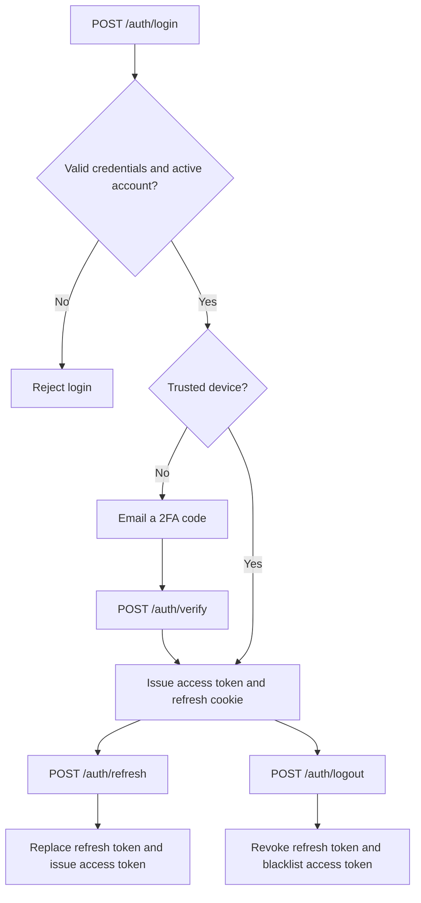

# Authentication and permissions

For API areas and request contracts, see the [API overview](api.md).
Unless stated otherwise, source paths in this document are relative to `backend/`.

## Session flow



Only active accounts may log in. Five consecutive failed password attempts lock an account for 15 minutes. A 2FA code expires after 5 minutes. Trusted-device reuse extends trust to 30 days from the current time.

| Contract | Access token | Refresh token |
|---|---|---|
| Secret | `JWT_SECRET` | `REFRESH_SECRET` |
| TTL | 4 hours | 8 hours |
| Sent as | `Authorization: Bearer` header | `httpOnly` cookie (`sameSite: 'strict'`, `secure` in production only) |
| Contains `role` + `permissions[]` | ✓ | ✗ |
| `tokenType` claim | `'access'` | `'refresh'` |
| Stored in DB | ✗ (blacklist only on logout) | ✓ (`user_refresh_tokens` table) |

---

## 3. RBAC Model

Route access and mutations are permission-based. Roles group permissions in the database and may also shape authorized results or presentation—for example, administrators can manage staff and youth accounts while staff can manage youth accounts only. A role check must never replace the route permission check.

Authorization has two layers: route permissions define the capability an actor may attempt, while domain policies under `src/policies/` define record scope. Services apply those policies inside authoritative reads and transaction-locked mutation lookups. Frontend restrictions mirror the policy for usability but are never the authorization boundary.

Staff program scope is assignment-based for every program. A program's `enrollment_required` flag controls whether youth must enroll before attendance; it does not automatically grant staff access. Administrators can assign both enrolled- and open-roster programs to staff accounts.

### Roles and their permissions

| Role | Permissions |
|------|-------------|
| `admin` | All currently defined permissions, including account, youth, programming, outreach, homepage, settings, and hours access |
| `staff` | Operational permissions assigned by migrations; account results and some workflows remain policy-scoped |
| `youth` | *(none)* |

### Permission definitions

| Permission | Grants |
|------------|--------|
| `read:accounts` | `GET /api/accounts` with policy-scoped results |
| `write:accounts` | Staff/admin account invitations and account status/invitation mutations |
| `read:youth_profiles` | `GET /api/youth` |
| `write:youth_profiles` | `POST /api/youth`, `PATCH /api/youth/:id` |
| `read:schools` | `GET /api/schools` |
| `write:schools` | `POST /api/schools`, `DELETE /api/schools/:id` |
| `read:programs` | Program, cycle, assignment, and enrollment lookups |
| `write:programs` | Manage programs, cycles, and program-cycle assignments (admin grant) |
| `write:enrollments` | Enroll and withdraw youth; required alongside outreach and youth-profile writes for Lead signup |
| `read:sessions` | Read sessions, session types, notes, attachments, and assigned scheduling reference data |
| `write:sessions` | Generate and manage sessions, notes, and attachments |
| `read:attendance` | Read session rosters and youth-centric cohort attendance records |
| `write:attendance` | Record and update attendance through session- or youth-centric workflows |
| `read:outreach` | Read expressions of interest and leads |
| `write:outreach` | Review/convert expressions of interest and create/update leads; Lead signup also requires `write:youth_profiles` and `write:enrollments` |
| `read:homepage` | Read managed homepage images and signup availability |
| `write:homepage` | Manage homepage images and public signup availability |
| `read:settings` | `GET /api/settings/*` *(reserved)* |
| `write:settings` | `POST /api/settings/*` *(reserved)* |
| `read:hours` | Read hours resources in policy scope: staff see themselves plus coworkers sharing any program assignment, including each visible coworker’s complete hours row; administrators see all |
| `write:hours` | Create, update, move, and delete policy-scoped logged hours; staff are self-scoped and administrators may act for any staff member |
| `read:tasks` | Read task resources in policy scope: staff see themselves plus coworkers sharing any program assignment, including each visible coworker’s complete task row; administrators see all |
| `write:tasks` | Create, update, change status, and delete policy-scoped tasks; staff are self-scoped and administrators may act for any staff member |

### How permissions flow into a token

Minimal shared lookups use the consuming workflow's capability rather than
requiring program or school management access. See [Reference data](reference-data.md)
for alternative lookup permissions, authenticated assigned-program labels, and
feature-specific staff scope. `requireAnyPermission(...)` accepts any listed
capability; `requirePermission(...)` continues to require all listed capabilities.

1. On login/verify, `authService.ts` JOINs `user_roles → user_role_has_permissions → user_permissions` to aggregate the user's full permission set into a `json_agg` array.
2. Both `role` (name string) and `permissions` (string array) are embedded in the **access token payload**.
3. `requirePermission(...required)` middleware reads `req.user.permissions` — it never reads `req.user.role`.
4. On refresh, a fresh permission set is re-fetched from DB so role changes take effect on the next rotation.

### Where to add a new permission

1. Add the string to the `Permission` union in `src/types/auth.ts`.
2. Add a new forward-only migration that inserts the permission into `user_permissions` and assigns it through `user_role_has_permissions`.
3. Add `requirePermission('new:permission')` to the relevant route in `src/routes/`.
4. Add the string to the `Permission` union in `frontend/src/auth/authContext.ts`.
5. Add permission and policy tests for every affected role.

---

## 4. Payload Type Hierarchy

Defined in `src/types/auth.ts`. This is the single source of truth for JWT payload shapes across both `authService.ts` and `authMiddleware.ts`.

```ts
// Base — common fields in every token
interface BaseTokenPayload {
  userId: string;
  email: string;
  jti: string;     // unique token ID for blacklisting / revocation
  iat?: number;    // issued at — stamped by jsonwebtoken on sign
  exp?: number;    // expiry — stamped by jsonwebtoken on sign
}

// Access token — adds role, permissions array, and type discriminator
interface AccessTokenPayload extends BaseTokenPayload {
  role: UserRole;            // used by domain policies for record scope, never as a route-capability substitute
  permissions: Permission[]; // e.g. ['read:youth_profiles', 'write:youth_profiles'] — used for all authz checks
  tokenType: 'access';
  iat: number;               // required on decoded tokens (always present after verify)
  exp: number;               // required on decoded tokens
}

// Refresh token — no permissions, just identity + type discriminator
interface RefreshTokenPayload extends BaseTokenPayload {
  tokenType: 'refresh';
  iat: number;
  exp: number;
}
```

`iat?/exp?` are optional on the base because you never pass them when signing — `jsonwebtoken` stamps them. The subtypes mark them required because after `jwt.verify()` they are always present, making `decoded.exp * 1000` safe without a non-null assertion.

---

## 5. Signing Helpers

`signAccessToken` and `signRefreshToken` in `authService.ts` are the only places in the codebase where tokens are signed. They own the secret, the expiry, and the `tokenType` stamp.

```ts
function signAccessToken(payload: Omit<AccessTokenPayload, 'iat' | 'exp' | 'tokenType'>): string {
  return jwt.sign({ ...payload, tokenType: 'access' }, JWT_SECRET, { expiresIn: ACCESS_TOKEN_EXPIRY });
}

function signRefreshToken(payload: Omit<RefreshTokenPayload, 'iat' | 'exp' | 'tokenType'>): string {
  return jwt.sign({ ...payload, tokenType: 'refresh' }, REFRESH_SECRET, { expiresIn: REFRESH_TOKEN_EXPIRY });
}
```

Signing stays in [authService.ts](../../backend/src/services/auth/authService.ts). Required secrets use `requireEnv()`. Access-token middleware verifies the signature, requires the access discriminator, and checks the revocation list before attaching `req.user`.

## Preserve session security

- Refresh checks the signature and a matching, unexpired, unrevoked database record. Replacement insertion and old-token revocation commit in one transaction.
- Tokens from one login share a token family. Reuse of a rotated-out refresh token revokes its family and requires login again.
- Refresh reloads role and permissions from the database. Permission changes take effect on rotation, not midway through an existing access token's lifetime.
- Consume one-time secrets atomically. 2FA uses a conditional update; password reset claims a valid token with a locked update. A separate read followed by a write can allow concurrent reuse.
- Password reset revokes the user's active refresh tokens and activates invited accounts.
- Logout handles either token independently and tolerates expired or invalid tokens. Access-token revocation updates the local cache immediately; other processes refresh their cache after 60 seconds.

Revocation is owned by [tokenRevocationService.ts](../../backend/src/services/auth/tokenRevocationService.ts). Logic shared by middleware and auth services belongs in services or utilities; services must not import middleware.

## Add or change a permission

Roles group permissions; route access checks require every named permission in `req.user.permissions`. A role check never replaces a route permission check. Record visibility and mutation scope follow the [authorization contract](authorization.md) and [policies](policies.md).

Staff program access is assignment-based for every program. `enrollment_required` changes youth enrollment and attendance behavior; it does not grant staff access. Administrators can assign both enrolled- and open-roster programs to staff.

1. Add the permission to the backend [Permission union](../../backend/src/types/auth.ts).
2. Add a forward migration inserting it into `user_permissions` and assigning roles through `user_role_has_permissions`.
3. Add `requirePermission(...)` to each affected route in the standard [middleware order](middleware.md#request-ordering).
4. Update the frontend [Permission union](../../frontend/src/auth/authContext.ts).
5. Test missing capabilities and the affected roles' record scope.

## Invite an account

The [account service](../../backend/src/services/accounts/accountService.ts) creates invited credentials with an unusable password and sends a 7-day activation link to `/reset-password?token=...`. Youth credential creation reuses this mechanism. The normal password-reset endpoint sets the password and promotes `invited` to `active`.

Account policies limit staff to youth accounts; administrators can manage staff and administrator accounts.

## Record auth events

Use [authLogService.ts](../../backend/src/services/auth/authLogService.ts) for login, lockout, 2FA, trusted-device, logout, password-reset, and token-reuse events. Its `AuthEvent` union owns the event names. Logging failures are reported without failing the auth operation.

Pass the request IP to the service; never store it raw. Auth logs store an HMAC-SHA256 hash of the IPv4 /24 or IPv6 /64 prefix. `LOG_HMAC_SECRET` overrides the `JWT_SECRET` fallback; a separate production secret allows independent rotation. Changing the HMAC secret changes correlation across logs. Email remains stored in plaintext, so IP hashing does not make these records anonymous.
