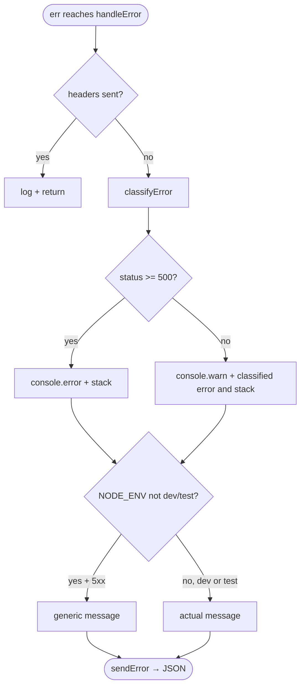
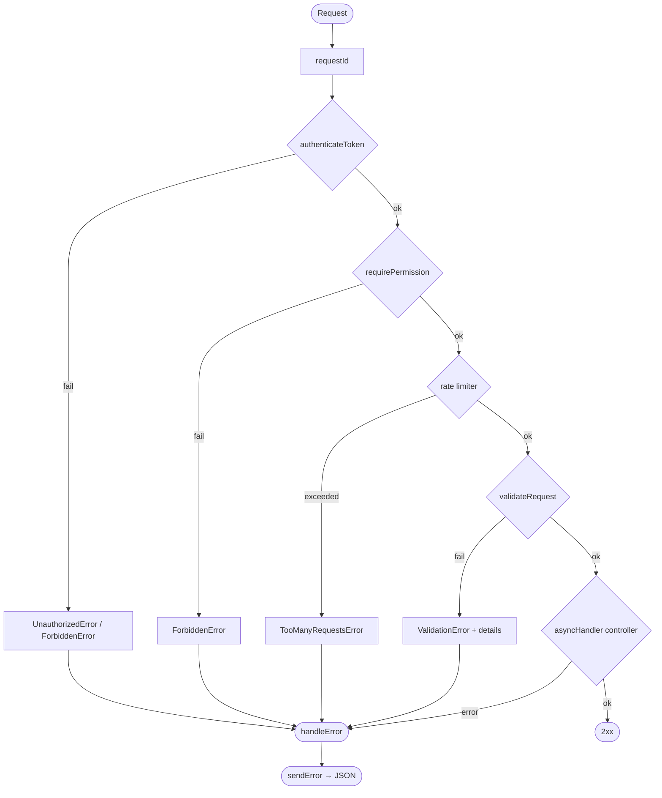

# Backend Error Handling

Unless stated otherwise, source paths in this document are relative to `backend/`.

## Overview

1. A service (or middleware) **throws a typed error** — e.g. `throw new NotFoundError('User not found')`
2. That error flows to the **global error handler**, which reads the status, logs it, and sends a JSON response
3. The client always gets the same shape — `{ error: "..." }`

Never `res.json()` an error. Just throw and the rest is handled.

### Error semantics and user messages

We adapt [Google AIP-193: Errors](https://google.aip.dev/193) for consistent
error classification and separation of diagnostic information from user-facing
messages across 4xx and 5xx responses. We retain this application's JSON response
shape rather than adopting Google's full error schema.

Return the appropriate non-2xx status when an operation fails. A missing requested
record or required parent returns `404`; an existing collection with no matching
items returns `200` with an empty collection. Apply the existing permission and
record-concealment policies before exposing resource existence; see
[Authorization](authorization.md).

Keep stacks, database details, and cause chains in backend logs, correlated by
request ID. Backend 4xx messages must be safe to expose; unexpected production
5xx responses use a safe message as described below. The frontend owns contextual,
user-friendly wording and an appropriate recovery action. Never turn a failed
request into successful empty data or display internal diagnostics to users.

For a `404` on a previously selected record, use the frontend message pattern
`This <record name> is no longer available.` For example, a missing lead returns
`404` with `{ "error": "Lead not found", "requestId": "abc-123" }`; the interface
shows “This lead is no longer available” with a “Back to leads” action. For a
direct link to a record whose prior existence is unknown, use `We couldn't find
this <record name>.` These are presentation patterns, not backend message strings.

Choose recovery by failure: validation errors identify fields to correct,
authentication errors follow the sign-in flow, conflicts explain what needs
refreshing or changing, and temporary service failures offer retry when safe.
Do not match backend message text to identify an error; use the HTTP status and
available typed details. A status alone does not prove which related record is
missing, so use specific wording only when the endpoint contract establishes it.

For further reading, see AIP-193's
[error messages](https://google.aip.dev/193#error-messages) and
[permission and not-found guidance](https://google.aip.dev/193#permission-denied),
and the [GOV.UK page-not-found pattern](https://design-system.service.gov.uk/patterns/page-not-found-pages/)
for plain-language recovery guidance. Our local authorization policies remain
authoritative where they deliberately conceal inaccessible records with `404`.

### Files

| File | What lives there |
|---|---|
| `src/errors.ts` | All error classes, `ErrorResponse` type, `ValidationDetail` type |
| `src/middleware/errorMiddleware.ts` | `classifyError`, `handleError`, `sendError` |
| `src/middleware/routeMiddleware.ts` | `asyncHandler`, `requestId` (UUID middleware), `validateRequest` (Zod → `ValidationError`) |
| `src/types/` | TypeScript shape declarations only — no runtime logic |

---

## 1. Error classes

```
AppError (base, 500)
├── BadRequestError        400
├── ValidationError        400  — carries details[] (Zod field errors)
├── UnauthorizedError      401
├── ForbiddenError         403
├── NotFoundError          404
├── ConflictError          409  — mapped from Postgres 23505
├── LockedError            423
├── TooManyRequestsError   429
├── DbConnectionError      503  — DB unreachable
├── ServiceUnavailableError 503 — upstream dependency down
└── InternalServerError    500  — unexpected error
```

```ts
import { NotFoundError } from '../errors';

throw new NotFoundError('User not found');
```

**Adding a new type:** subclass `AppError`, set `statusCode` and `name` — the handler picks it up automatically.

**Rule:** always `throw` — never call `sendError()` from outside `handleError`.

> `ConflictError` (409) is automatically thrown by `classifyError()` in `errorMiddleware.ts` when Postgres raises a `23505` unique_violation. The original DB error is passed as `cause`, so the constraint name is visible in logs. You can also throw it directly from a service for semantic conflicts.

---

## 2. Response shape

```ts
{
  error: string;           // always present
  details?: [              // validation errors only
    { field: string; message: string }
  ];
  requestId?: string;      // present on every response (requestId middleware runs first in index.ts)
}
```

**Example — wrong password:**
```json
{ "error": "Invalid email or password", "requestId": "abc-123" }
```

**Example — validation failure:**
```json
{
  "error": "Validation failed",
  "details": [{ "field": "email", "message": "Invalid email address" }],
  "requestId": "def-456"
}
```

---

## 3. Global error handler

`handleError` is registered last in `index.ts`. Flow: `classifyError` → status + log → `sendError`.

- Headers already sent → log + bail
- Status from `appErr.statusCode` (clamped 400–599, else 500)
- 5xx → `console.error`; 4xx → `console.warn`. Both include request ID, method, path, status, error class, message, and the classified `Error` object so Docker logs retain the originating stack, validation details, and cause chain.
- `isDev` = `NODE_ENV === 'development' || NODE_ENV === 'test'`; non-`isDev` 5xx → `appErr.clientMessage ?? 'An unexpected error occurred'`; 4xx and `isDev` always show the actual message



### DB error classification

`classifyError()` promotes raw throws into typed `AppError`s before logging:

- Already an `AppError` → returned as-is
- Connection failures (`ECONNREFUSED`, `57P03`, pool exhaustion, etc.) → `DbConnectionError` (503)
- `23505` unique violation → `ConflictError` (409), original postgres error passed as `cause`
- Everything else → `InternalServerError` (500)

Classification preserves the original thrown value as `Error.cause`, so wrapping an unknown failure never discards its low-level stack or metadata in server logs.

> The `/health` endpoint pings the DB directly and returns `{ status: 'ok'|'degraded', db: 'connected'|'unavailable' }` with 200 or 503.

---

## 4. `asyncHandler`

Express 4 silently drops async errors without it. Every route must use it — no exceptions.

```ts
// correct — error forwarded to the global handler
router.get('/', authenticateToken, asyncHandler(handleGetYouth));

// wrong — error silently disappears in Express 4
router.get('/', authenticateToken, handleGetYouth);
```

No `try/catch` needed in controllers — just throw.

---

## 5. Request flow

This shows the flow for a **protected route** such as `/api/accounts`, `/api/youth`, or `/api/schools`. Auth routes (`/api/auth/*`) skip `authenticateToken` and `requirePermission` and use a separate `authLimiter`; public routes use their own rate-limit and validation chains.



---

## 6. Request tracing

Every request gets a UUID on arrival (`requestId` middleware, first in `index.ts`). Stored on `res.locals.requestId`, returned as `X-Request-ID` header, included in every error response and log line.

Pass `X-Request-ID` in the request to override (useful for cross-service tracing).

---

## 7. Crash protection

`src/index.ts` registers `uncaughtException` and `unhandledRejection` handlers — both log and call `process.exit(1)` so Docker restarts cleanly. Both are disabled in `NODE_ENV=test`.

---

## 8. Frontend

`ErrorBoundary` wraps the app and catches render-phase errors. Does **not** catch event handler or async errors.

Typed errors used by the HTTP client live in `frontend/src/http/errors.ts`
and `frontend/src/auth/accessToken.ts`:

| Class | When |
|---|---|
| `ApiError(status, message, details?, requestId?)` | Server returned 4xx/5xx |
| `SessionError` | A protected call cannot obtain a valid session |
| `NetworkError` | `fetch` threw — no connection |
| `RequestTimeoutError` | AbortController timeout fired |

All HTTP calls go through `apiClient`. Use `ApiError.status` for contextual error
presentation and `err instanceof ApiError && err.details` for field-level validation
errors. `getErrorMessage(err, fallback)` extracts a message; it does not sanitize
developer diagnostics or translate statuses into user-facing wording. Follow the
[message policy above](#error-semantics-and-user-messages) at the owning workflow.
