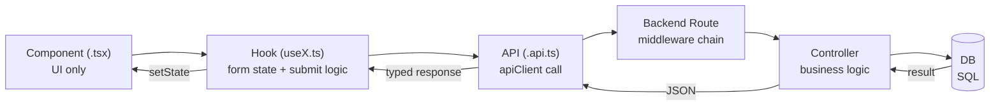
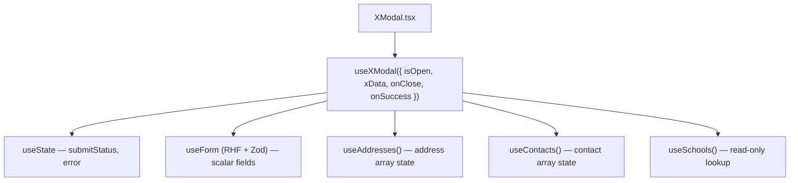
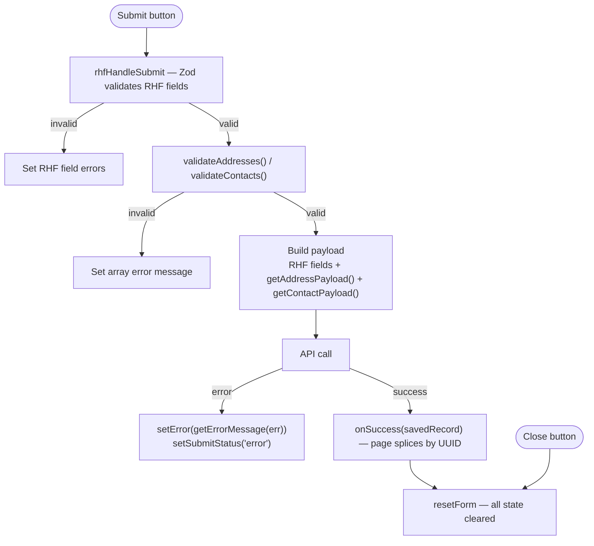
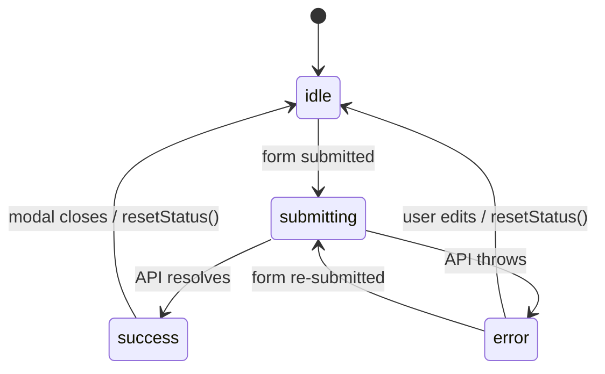

# Frontend Structure

This project uses page-scoped organization with a small `common/` area for shared code.

## Goals
- Keep page logic co-located (UI + hooks + API + validation).
- Promote shared code only when reused by 2+ pages.
- Make imports predictable and reduce cross-folder hopping.

## Data Flow

Every request follows the same path through the stack:



### Example: Login

1. **Login.tsx** — renders the form, delegates to `useLogin()` hook
2. **useLogin.ts** — React Hook Form + Zod validates fields, calls `login()` from auth.api.ts on submit
3. **auth.api.ts** — `apiClient.post('/auth/login', { email, password }, { auth: false })` sends JSON to backend via the centralized API client
4. **authRoutes.ts** — `POST /api/auth/login` → rate limiter → Zod body validation → controller
5. **authController.ts** — queries DB for user, bcrypt compares password, generates 2FA code or JWT
6. **client.ts** — `sql` tagged template executes parameterized queries against PostgreSQL

Response flows back: DB → controller JSON response → fetch resolves → hook stores token → component re-renders.

## Layout

`common/` contains all shared code — annotated below. `pages/` follows the page-scoped pattern described in the rules below; each page is self-contained.

```
src/
  common/
    api/
      client.ts           ← apiClient — all HTTP calls go through here
      config.ts           ← api() URL helper
      sessionExpired.ts   ← awaitReLogin / resolveReLogin
      tokenRefresh.ts     ← proactive refresh with deduplication
    components/
      AuthLayout/         ← shared wrapper for auth pages
      Button/
      ErrorBoundary/      ← wraps entire app, catches render errors
      Footer/
      Header/
      Modal/
      ProtectedRoute/     ← redirects unauthenticated users
      PublicTopBar/
      ReLoginModal/       ← shown when access token expires mid-session
      Table/              ← shared data table
    context/
      AuthContext.tsx     ← isAuthenticated, user, setAuthData, clearAuthData
    hooks/
      useAddresses.ts     ← entity-agnostic address array state
      useContacts.ts      ← entity-agnostic contact array state
      useSchools.ts       ← read-only school lookup
      useSubmitStatus.ts  ← SubmitStatus type + state pair for modal hooks
    styles/
      brand.css
      forms.css
    utils/
      errors.ts           ← ApiError, AuthError, NetworkError, RequestTimeoutError, getErrorMessage
      jwt.ts              ← isTokenExpired, getTimeUntilExpiry (client-side decode only)
      storage.ts          ← getToken, setAuthData, clearAuthData, getUser
      deviceFingerprint.ts
      time.ts
  pages/
    Auth/                 ← login, verify, forgot, reset — common/api + per-page hooks
    Homepage/
    Settings/
    Staff/                ← Staff.tsx + api/ + hooks/ + (no modal yet)
    Youth/                ← Youth.tsx + api/ + hooks/ + components/YouthModal/
```

## Rules of Thumb
- Page-specific API, hooks, and components live under that page.
- Shared utilities live in `common/utils`.
- Shared UI components live in `common/components`.
- Shared app state lives in `common/context`.
- API config lives in `common/api`.
- `common/` never imports from `pages/`. Dependencies flow one way: `pages/ → common/`.

## Promotion Criteria
Move code to `common/` when:
- It is used by 2+ pages, and
- The behavior is stable and not page-specific.

## Naming
- Pages use PascalCase folders (e.g., `Auth`, `Users`).
- Hooks follow `useX.ts` naming.
- API files end with `.api.ts`.

---

## State Architecture

### Overview

State is split by concern and lives as close to where it is used as possible. There are three tiers:

| Tier | What it owns | Where it lives |
|---|---|---|
| Page state | Master list of records | `pages/X/hooks/useX.ts` |
| Modal state | Form fields, submit status | `pages/X/components/XModal/useXModal.ts` |
| Sub-entity state | Dynamic arrays (contacts, addresses) | `common/hooks/` |

---

### Pattern: Page + Modal

Every data page follows this structure:

```
pages/X/
  X.tsx                          ← renders table + modal, owns master list state
  hooks/
    useX.ts                      ← fetches list on mount, exposes setX for updates
  components/
    XModal/
      XModal.tsx                 ← pure UI, no logic
      useXModal.ts               ← all form logic, submit, state orchestration
      xSchema.ts                 ← Zod schema for RHF fields
```



---

### Page State — Master List

The page hook fetches once on mount and exposes `setX` for local updates:

```ts
// Standard page hook shape
export function useX() {
  const [items, setItems] = useState<XProfile[]>([]);
  const [loading, setLoading] = useState(true);
  const [error, setError] = useState('');
  const load = async () => { ... };
  useEffect(() => { load(); }, []);
  return { items, setItems, loading, error, refetch: load };
}
```

After a modal save, the page updates its list by UUID splice — no full refetch:

```ts
// UPDATE — swap one row by id
setItems(prev => prev.map(x => x.id === saved.id ? saved : x));

// CREATE — append
setItems(prev => [...prev, saved]);

// DELETE — remove
setItems(prev => prev.filter(x => x.id !== deletedId));
```

---

### Modal State Lifecycle

**Mount (create mode):** all state initializes to empty defaults.

**Open with existing record (edit mode):** `useEffect` fires and distributes the record across state owners:

```ts
useEffect(() => {
  if (!isOpen || !data) return;
  reset({ ...scalarFields });        // → RHF
  initAddresses(data.addresses);     // → useAddresses
  initContacts(data.contacts);       // → useContacts
}, [isOpen, data]);
```

The incoming record (`data`) is never mutated. It is the pre-fill source only.

**User edits:** each state owner handles its own slice independently. Edits to contacts do not affect RHF state and vice versa.

**Submit / Close:**



---

### Sub-Entity Hooks (useContacts, useAddresses)

These hooks are entity-agnostic. They manage an array without knowing what the parent entity is.

```ts
// Same hook, any entity
const contacts = useContacts();   // youth, staff, school, partner — doesn't matter
const addresses = useAddresses();
```

Standard interface every sub-entity hook exposes:

| Method | Purpose |
|---|---|
| `initialize(data)` | Pre-fill from existing record on modal open |
| `reset()` | Wipe back to one empty row on modal close |
| `handleChange(index, field, value)` | Update one field on one row |
| `validate()` | Returns error string or undefined — skips blank rows |
| `getPayload()` | Returns filtered, trimmed array ready for API |

Partial validation rule: if all fields on a row are empty, the row is skipped. Only rows with any data filled in are validated and included in the payload.

---

### Submit State Machine

Every modal hook uses `useSubmitStatus()` from `common/hooks/useSubmitStatus.ts`:

```ts
const { submitStatus, setSubmitStatus, error, setError, resetStatus } = useSubmitStatus();
```

It encapsulates the state pair and exposes a `resetStatus()` helper that clears both at once. `SubmitStatus` is exported from the same file:



Only one status can be true at a time — no contradictory states possible.

---

### Save Flow — Upsert Returns Full Record

The save flow does a single request. `setYouth` / `setStaff` return the full saved record directly — the upsert endpoint runs the same SELECT as the GET endpoint and returns it in one response:

```ts
const savedYouth = await setYouth(payload);  // returns full YouthProfile
onSuccess(savedYouth);                        // page splices by UUID
```
