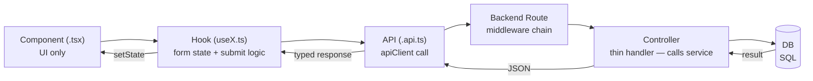
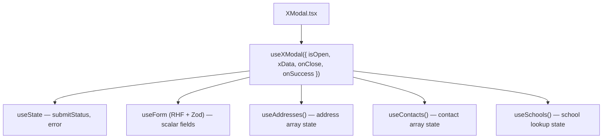
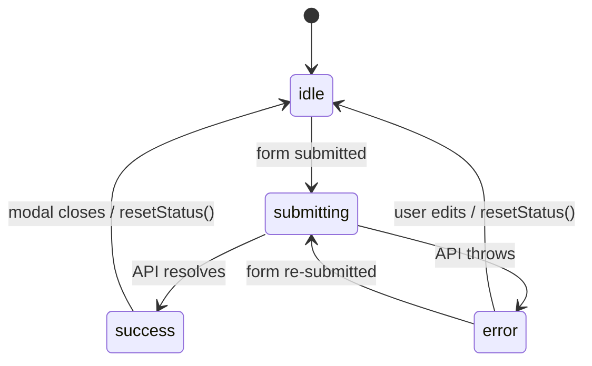

# Frontend Structure

This project uses page-scoped organization with a small `common/` area for shared code.

## Goals
- Keep page logic co-located (UI + hooks + API + validation).
- Promote shared code only when reused by 2+ pages.
- Make imports predictable and reduce cross-folder hopping.

## Data Flow

Every request follows the same path through the stack:



### Example: Login

1. **Login.tsx** — renders the form, delegates to `useLogin()` hook
2. **useLogin.ts** — React Hook Form + Zod validates fields, calls `login()` from auth.api.ts on submit
3. **auth.api.ts** — `apiClient.post('/auth/login', { email, password }, { auth: false })` sends JSON to backend via the centralized API client
4. **authRoutes.ts** — `POST /api/auth/login` → rate limiter → Zod body validation → controller
5. **authController.ts** — thin handler: extracts params, calls `authService`, returns JSON
6. **client.ts** — `sql` tagged template executes parameterized queries against PostgreSQL

Response flows back: DB → controller JSON response → fetch resolves → hook stores token → component re-renders.

## Layout

`common/` contains all shared code — annotated below. `pages/` follows the page-scoped pattern described in the rules below; each page is self-contained.

```
src/
  ErrorBoundary.tsx      ← root render-failure boundary with a dependency-free reload fallback
  ErrorBoundary.css      ← standalone fallback styles that remain usable if the app tree fails
  ErrorBoundary.test.tsx ← verifies replacement UI and focus management
  common/
    api/
      client.ts           ← apiClient — all HTTP calls go through here
      config.ts           ← api() URL helper
      sessionExpired.ts   ← awaitReLogin / resolveReLogin
      tokenRefresh.ts     ← proactive refresh with deduplication
      programs.api.ts     ← canonical program lookup API
    components/
      ActionsMenu/        ← shared row actions dropdown (uses FloatingMenuPanel)
      AuthLayout/         ← shared wrapper for auth pages
      Button/
      FloatingMenuPanel/  ← shared floating menu portal + keyboard nav
      Footer/
      FormField/          ← shared labelled form field wrapper
      Header/             ← sidebar + settings flyout (uses FloatingMenuPanel)
      Modal/
      ModalFormFooter/    ← shared save/cancel footer for modal forms
      ProtectedRoute/     ← redirects unauthenticated users
      PublicTopBar/       ← public top bar + mobile menu (uses FloatingMenuPanel)
      ReLoginModal/       ← shown when access token expires mid-session
      Table/              ← shared data table
      TableDetailLayout/  ← selected-row cards above table on desktop and below on mobile
      DetailCards/        ← shared primary-contact and notes cards
    context/
      AuthContext.tsx     ← isAuthenticated, role, permissions, loading, login, logout
    hooks/
      useAddresses.ts     ← entity-agnostic address array state
      useConfirmModal.tsx ← reusable confirm/delete modal state
      useContacts.ts      ← entity-agnostic contact array state
      usePrograms.ts      ← program lookup state shared by Lead and Youth workflows
      useSchools.ts       ← school lookup state shared by Youth workflows
      useSubmitStatus.ts  ← SubmitStatus type + state pair for modal hooks
    styles/
      brand.css
      forms.css
      pages.css
    types/
      school.ts           ← cross-page domain types
    hooks/
      useFloatingMenu.ts  ← shared hook: open/close/position state, dismiss, keyboard, focus management
    utils/
      clientErrors.ts     ← ApiError, AuthError, NetworkError, RequestTimeoutError, getErrorMessage
      floatingPosition.ts ← pure position calculator: calculateFloatingPosition(anchor, placement, options)
      floatingMenuUtils.ts← getMenuItems(el) — shared helper used by FloatingMenuPanel + useFloatingMenu
      jwt.ts              ← decodeToken, isTokenExpired, getTokenExpiry, getTimeUntilExpiry (client-side decode only)
      storage.ts          ← STORAGE_KEYS, setAuthData, clearAuthData, getToken, getUser, hasAuthToken
      deviceFingerprint.ts
      time.ts
  pages/
    Auth/                 ← login, verify, forgot, reset — common/api + per-page hooks
    Homepage/             ← Homepage.tsx + hooks/useSectionRouting.ts + section feature folders
    Outreach/             ← expression review + lead management feature folders
    Settings/             ← account settings + Users account management
    Youth/                ← Youth.tsx + types.ts + api/ + hooks/ + components/YouthModal/
```

## Rules of Thumb
- Page-specific API, hooks, and components live under that page.
- Shared utilities live in `common/utils`.
- Shared UI components live in `common/components`.
- Shared app state lives in `common/context`.
- API config lives in `common/api`.
- `common/` never imports from `pages/`. Dependencies flow one way: `pages/ → common/`.

### Feature-folder pattern

When a page-specific unit grows beyond a thin presentational component, give it its own folder and colocate the moving pieces:

```text
components/
  SignupSection/
    SignupSection.tsx
    useSignupSection.ts
    signupSectionSchema.ts
    SignupSection.test.tsx
```

The same pattern applies to modal features such as `YouthModal/` and to homepage sections such as `HeroSection/` and `ProgrammingSection/`.

---

## Floating Menu System

All dropdown/flyout menus use a shared 3-piece system instead of bespoke per-component implementations.

### Pieces

| File | Role |
|---|---|
| `common/utils/floatingPosition.ts` | Pure position calculator — no React, independently testable. Takes anchor `HTMLElement` + `placement` + `options`, returns `{ top, left }` in viewport coords for `position: fixed`. Handles collision detection and axis flipping. |
| `common/hooks/useFloatingMenu.ts` | All behavior — open/close state, position calculation, `pointerdown` dismiss, `scroll`/`resize` close, focus-first-item on open, return-focus-to-trigger on close. |
| `common/components/FloatingMenuPanel/` | Portal renderer. Renders a `role="menu"` div via `createPortal` at the calculated position. Handles `Escape`/`Tab`/Arrow keyboard navigation. |

### Placement model

```ts
// { side, align? } — passed as second arg to useFloatingMenu
{ side: 'bottom', align: 'end' }   // ActionsMenu — opens below, right-aligned
{ side: 'right',  align: 'start' } // Header settings flyout — opens to the right
{ side: 'bottom', align: 'end' }   // PublicTopBar mobile menu — opens below, right-aligned
```

Collision detection flips side/alignment automatically if the preferred position would overflow the viewport.

### Usage pattern

```tsx
import { useRef } from 'react';
import { useFloatingMenu } from '../../hooks/useFloatingMenu';
import FloatingMenuPanel from '../FloatingMenuPanel/FloatingMenuPanel';

export default function MyMenu() {
  const triggerRef = useRef<HTMLButtonElement>(null);
  const { isOpen, toggle, close, position, menuRef } = useFloatingMenu(
    triggerRef,
    { side: 'bottom', align: 'end' },
    { widthEstimate: 180, heightEstimate: 120 },
  );

  return (
    <>
      <button ref={triggerRef} onClick={toggle}>Open</button>
      {position && (
        <FloatingMenuPanel menuRef={menuRef} position={position} onClose={close}>
          <button role="menuitem">Action</button>
        </FloatingMenuPanel>
      )}
    </>
  );
}
```

### Shared item styles

`FloatingMenuPanel.css` owns the base `[role="menuitem"]` styles (block layout, padding, font, border-radius, hover). Consumers override only what differs:

```css
/* Consumer override — must use .floating-menu-panel prefix for specificity (0-3-0) */
.floating-menu-panel .my-item:hover { background: var(--accent-10); }
```

---

## Test Infrastructure

**Framework:** Vitest + jsdom + `@testing-library/react` + `@testing-library/jest-dom`.

**Run:** `npm test` (single run, used by Vitest directly) · `npm run test:watch` (dev watch mode).

**Repo-level runners:** use `../scripts/frontend/test-ui.sh` for the full frontend suite, or the page/path-based runners in `../scripts/frontend/` such as `run-homepage-tests.sh`, `run-youth-tests.sh`, and `run-common-tests.sh`.

**Setup file:** `src/tests/setup.ts` — imports `@testing-library/jest-dom` to extend `expect`.

**Config:** `vite.config.ts` uses `vitest/config` import with `test: { environment: 'jsdom', globals: true, setupFiles: ['./src/tests/setup.ts'] }`.

### Existing test files

| File | What it tests |
|---|---|
| `src/ErrorBoundary.test.tsx` | Root render-failure fallback, accessible naming, and focus management |
| `src/common/utils/floatingPosition.test.ts` | Pure unit tests for `calculateFloatingPosition` — placement, side flip, alignment flip, custom offset |
| `src/common/components/ActionsMenu/ActionsMenu.test.tsx` | Component tests — render, open/close, item handler, Escape, toggle, disabled state |
| `src/pages/Homepage/Homepage.test.tsx` | Page-composition test for the public homepage sections |
| `src/pages/Homepage/components/HeroSection/HeroSection.test.tsx` | Hero carousel rendering and photo navigation |
| `src/pages/Homepage/components/ProgrammingSection/ProgrammingSection.test.tsx` | Programming section composition |
| `src/pages/Homepage/components/ProgrammingSection/ProgramCard/ProgramCard.test.tsx` | Program card rendering |
| `src/pages/Homepage/components/SignupSection/SignupSection.test.tsx` | Public expression-of-interest submission behavior |
| `src/pages/Outreach/Outreach.test.tsx` | Outreach navigation and view selection |
| `src/pages/Outreach/Leads/Leads.test.tsx` | Lead list, filtering, and actions |
| `src/pages/Settings/Users/Users.test.tsx` | Role-scoped account management behavior |
| `src/pages/Youth/Youth.test.tsx` | Youth profile page behavior |
| `src/pages/Youth/components/YouthModal/YouthModal.test.tsx` | Youth modal rendering, validation, and submit payload behavior |

### Key patterns

- **Mock `getBoundingClientRect`** when testing `floatingPosition.ts`: `vi.spyOn(el, 'getBoundingClientRect').mockReturnValue({...} as DOMRect)`
- **Portal menus**: `FloatingMenuPanel` renders via `createPortal` to `document.body` — `screen` queries the full document so portal children are always found
- **Keyboard events on `document`**: `fireEvent.keyDown(document, { key: 'Escape' })` reaches `FloatingMenuPanel`'s listener correctly

### Type Ownership

Each page owns a `types.ts` that declares its page-specific domain interfaces (e.g. `Lead`, `SetLeadInput`). Truly shared types live in `common/types/` (e.g. `Account`, `School`, and `YouthProfile`).

Dependency direction within a page:

```
types.ts        ← pure, no runtime imports
  ↑
api/*.api.ts    ← imports types, types its apiClient.get<T>/post<T> calls
  ↑
hooks/use*.ts   ← imports types + api functions, returns typed state
  ↑
components/     ← imports types + hooks
```

**Rules:**
- API modules type their `apiClient` calls with the domain interface — never leave them as `unknown`.
- Hooks and components must NOT cast (`data as Foo[]`) — if a cast is needed, the API function is missing a type parameter.
- A page never imports another page's `types.ts`. If two pages need the same type, promote it to `common/types/`.

## Promotion Criteria
Move code to `common/` when:
- It is used by 2+ pages, and
- The behavior is stable and not page-specific.

## Naming
- Pages use PascalCase folders (e.g., `Auth`, `Users`).
- Hooks follow `useX.ts` naming.
- API files end with `.api.ts`.

---

## State Architecture

### Overview

State is split by concern and lives as close to where it is used as possible. There are three tiers:

| Tier | What it owns | Where it lives |
|---|---|---|
| Page state | Master list of records | `pages/X/hooks/useX.ts` |
| Modal state | Form fields, submit status | `pages/X/components/XModal/useXModal.ts` |
| Sub-entity state | Dynamic arrays (contacts, addresses) | `common/hooks/` |

---

### Pattern: Page + Modal

Every data page follows this structure:

```
pages/X/
  X.tsx                          ← renders table + modal, owns master list state
  hooks/
    useX.ts                      ← fetches list on mount, exposes setX for updates
  components/
    XModal/
      XModal.tsx                 ← pure UI, no logic
      useXModal.ts               ← all form logic, submit, state orchestration
      xSchema.ts                 ← Zod schema for RHF fields
```



---

### Page State — Master List

The page hook fetches once on mount and exposes `setX` for local updates:

```ts
// Standard page hook shape
export function useX() {
  const [items, setItems] = useState<XProfile[]>([]);
  const [loading, setLoading] = useState(true);
  const [error, setError] = useState('');
  const load = async () => { ... };
  useEffect(() => { load(); }, []);
  return { items, setItems, loading, error, refetch: load };
}
```

After a modal save, the page updates its list by UUID splice — no full refetch:

```ts
// UPDATE — swap one row by id
setItems(prev => prev.map(x => x.id === saved.id ? saved : x));

// CREATE — append
setItems(prev => [...prev, saved]);

// DELETE — remove
setItems(prev => prev.filter(x => x.id !== deletedId));
```

---

### Modal State Lifecycle

**Mount (create mode):** all state initializes to empty defaults.

**Open with existing record (edit mode):** `useEffect` fires and distributes the record across state owners:

```ts
useEffect(() => {
  if (!isOpen || !data) return;
  reset({ ...scalarFields });        // → RHF
  initAddresses(data.addresses);     // → useAddresses
  initContacts(data.contacts);       // → useContacts
}, [isOpen, data]);
```

The incoming record (`data`) is never mutated. It is the pre-fill source only.

**User edits:** each state owner handles its own slice independently. Edits to contacts do not affect RHF state and vice versa.

**Submit / Close:**


---

### Sub-Entity Hooks (useContacts, useAddresses)

These hooks are entity-agnostic. They manage an array without knowing what the parent entity is.

```ts
// Same hook, any entity
const contacts = useContacts();   // youth, staff, school, partner — doesn't matter
const addresses = useAddresses();
```

Standard interface every sub-entity hook exposes:

| Method | Purpose |
|---|---|
| `initialize(data)` | Pre-fill from existing record on modal open |
| `reset()` | Wipe back to one empty row on modal close |
| `handleChange(index, field, value)` | Update one field on one row |
| `validate()` | Returns error string or undefined — skips blank rows |
| `getPayload()` | Returns filtered, trimmed array ready for API |

Partial validation rule: if all fields on a row are empty, the row is skipped. Only rows with any data filled in are validated and included in the payload.

---

### Submit State Machine

Every modal hook uses `useSubmitStatus()` from `common/hooks/useSubmitStatus.ts`:

```ts
const { submitStatus, setSubmitStatus, error, setError, resetStatus } = useSubmitStatus();
```

It encapsulates the state pair and exposes a `resetStatus()` helper that clears both at once. `SubmitStatus` is exported from the same file:



Only one status can be true at a time — no contradictory states possible.

---

### Save Flow — Upsert Returns Full Record

The save flow does a single request. Write APIs return the full saved record directly so the page can update local state without a follow-up fetch:

```ts
const savedYouth = await setYouth(payload);  // returns full YouthProfile
onSuccess(savedYouth);                        // page splices by UUID
```
